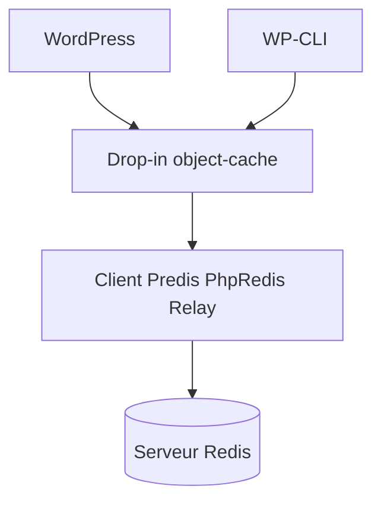

# rhubarbgroup/redis-cache

> Persistent object cache for WordPress on Redis, with Predis, PhpRedis, Relay and WP-CLI.

## The problem
WordPress reruns the same database queries on every page, for lack of an object cache that persists between requests.

## What it actually does
- An object-cache drop-in that stores keys in Redis.
- Configuration via `WP_REDIS_*` constants: host, port, database, prefix, ACL password, TLS, Unix socket.
- Handles replication, sharding, Sentinel and cluster, depending on the chosen client.
- Commands `wp redis status`, `enable`, `disable` and `update-dropin`.

## How it is wired

Simplified diagram based on the sheet, no diagram provided.

## Trying it
```bash
wp redis status
wp redis enable
wp redis disable
wp redis update-dropin
```

## Cost and gotchas
A reachable Redis server is required. Some options (`WP_REDIS_GRACEFUL`, selective flush) are declared unsupported, the first of which may corrupt data. Promotional banners exist, and can be disabled.

## What it is not
Not a page cache nor a generic Redis tool. Object Cache Pro, the commercial offering, is a separate version. GPL license.

## Alternatives
No alternative named in the README.

## For you
Ignore: no link to data, AI or MLOps, unless you self-host a WordPress.
