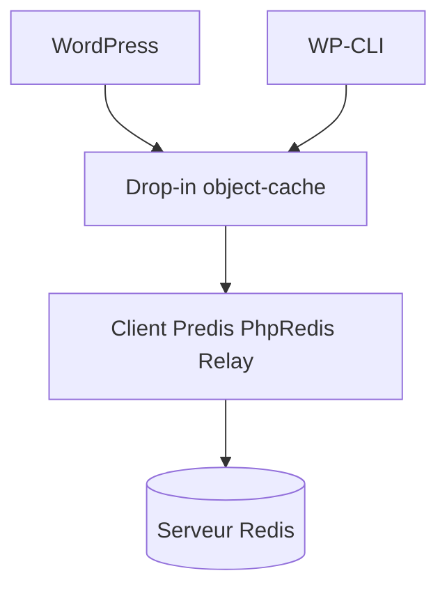

# rhubarbgroup/redis-cache

> Cache d'objets persistant pour WordPress sur Redis, avec Predis, PhpRedis, Relay et WP-CLI.

## Le problème
WordPress relance les mêmes requêtes en base à chaque page, faute de cache d'objets persistant entre les requêtes.

## Ce que ça fait vraiment
- Un drop-in de cache d'objets qui stocke les clés dans Redis.
- Configuration par constantes `WP_REDIS_*` : hôte, port, base, préfixe, mot de passe ACL, TLS, socket Unix.
- Gère réplication, sharding, Sentinel et cluster, selon le client choisi.
- Commandes `wp redis status`, `enable`, `disable` et `update-dropin`.

## Comment c'est branché

Schéma simplifié d'après la fiche, sans diagramme fourni.

## Essayer
```bash
wp redis status
wp redis enable
wp redis disable
wp redis update-dropin
```

## Coût et pièges
Il faut un serveur Redis accessible. Certaines options (`WP_REDIS_GRACEFUL`, flush sélectif) sont déclarées non supportées, la première pouvant corrompre des données. Des bandeaux promotionnels existent, désactivables.

## Ce que ce n'est pas
Pas un cache de pages ni un outil Redis générique. Object Cache Pro, l'offre commerciale, est une version distincte. Licence GPL.

## Alternatives
Aucune alternative nommée dans le README.

## Pour toi
À ignorer : aucun lien avec la donnée, l'IA ou le MLOps, sauf si tu héberges toi-même un WordPress.

