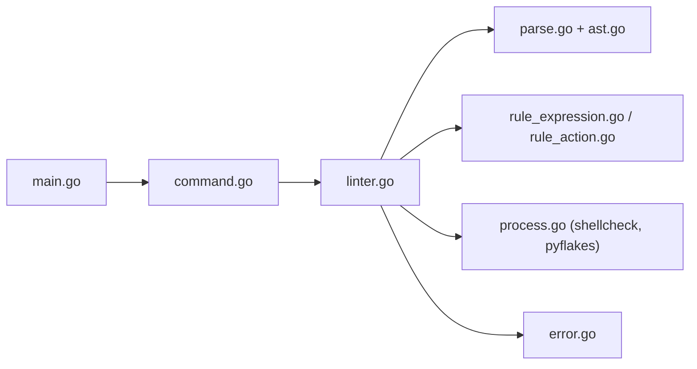

# rhysd/actionlint

> Static checker for GitHub Actions workflow files, with type checking of expressions.

## The problem
A key typo, a badly typed `${{ }}` expression or a script injection is only discovered when the workflow runs, after cycles of pushes.

## What it actually does
Reads the YAML files in `.github/workflows`, parses them into an AST and applies rules: syntax, expression types, action inputs and outputs, reusable workflows, injection through untrusted inputs, hard-coded secrets, globs, `needs:`, runner labels, cron. Can call shellcheck and pyflakes on `run:` steps. The README shows an example workflow with 7 detected errors.

## How it is wired


## Trying it
```bash
go install github.com/rhysd/actionlint/cmd/actionlint@latest
actionlint
```

## Cost and gotchas
Free. An online playground runs in WebAssembly in the browser. Self-hosted runner labels are declared in `actionlint.yaml`.

## What it is not
Does not check the real behavior of actions or of secrets on the GitHub side. 190 open issues, including possible false positives.

## Alternatives
No alternative named in the README (reviewdog, super-linter and pre-commit appear there as integrations).

## For you
Adopt: your CI and ML deployment pipelines depend on these workflows, and a free, proven local linter saves push round-trips.
