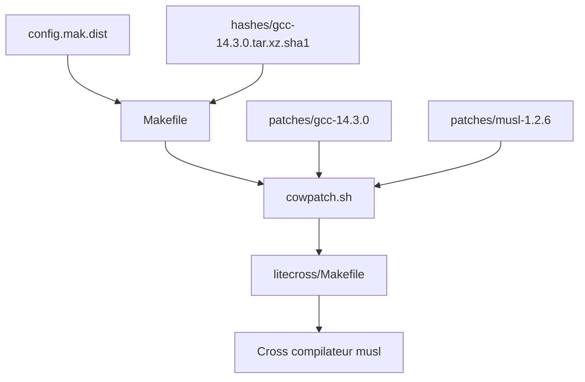

# richfelker/musl-cross-make

> Makefiles that produce GCC cross-compilers targeting the musl libc, for many architectures.

## The problem
Building a cross-compilation toolchain for musl requires chaining GCC, binutils and musl with the right patches.

## What it actually does
The main Makefile downloads the archives, checks their hashes, applies patches via cowpatch.sh, then hands over to litecross/Makefile, which builds GCC, binutils and musl in a single chain. You choose the target with `TARGET` (e.g. i486-linux-musl) in config.mak. Installation can go to a relocatable directory of your choice.

## How it is wired


## Trying it
```bash
make
make install
```
With a config.mak file containing at least `TARGET`.

## Cost and gotchas
Free. Compiling GCC takes time and disk space. The MIT license does not cover the patches or the produced binaries: they keep the upstream license.

## What it is not
It is not a heavily maintained project: the author describes it as a side activity for the benefit of musl.

## Alternatives
Gregor's musl-cross is cited as the original alternative system.

## For you
Worth watching: useful if you need to produce static binaries for ARM or embedded targets; otherwise useless.
