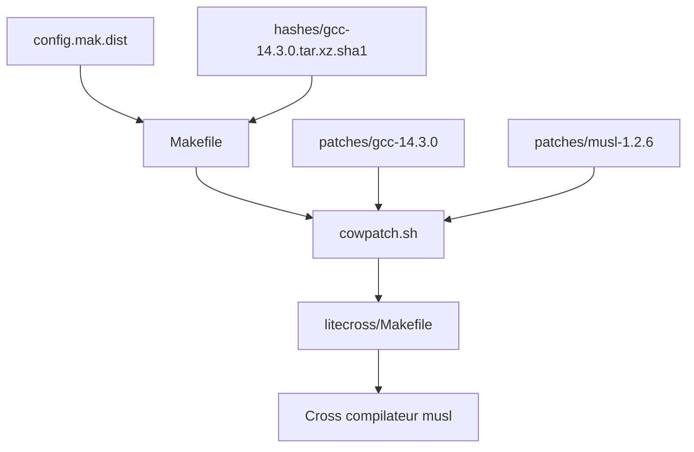

# richfelker/musl-cross-make

> Makefiles qui produisent des compilateurs croisés GCC ciblant la libc musl, pour de nombreuses architectures.

## Le problème
Construire une chaîne de compilation croisée vers musl impose d'enchaîner GCC, binutils et musl avec les bons patches.

## Ce que ça fait vraiment
Le Makefile principal télécharge les archives, vérifie leurs empreintes, applique les patches via cowpatch.sh, puis passe la main à litecross/Makefile qui construit GCC, binutils et musl en une seule chaîne. On choisit la cible par `TARGET` (ex. i486-linux-musl) dans config.mak. L'installation se fait au choix dans un répertoire déplaçable.

## Comment c'est branché


## Essayer
```bash
make
make install
```
Avec un fichier config.mak contenant au minimum `TARGET`.

## Coût et pièges
Gratuit. La compilation de GCC prend du temps et du disque. La licence MIT ne couvre pas les patches ni les binaires produits : ils gardent la licence amont.

## Ce que ce n'est pas
Ce n'est pas un projet à fort entretien : l'auteur le décrit comme une activité annexe au bénéfice de musl.

## Alternatives
musl-cross de Gregor est cité comme système alternatif d'origine.

## Pour toi
À surveiller : utile si tu dois produire des binaires statiques pour ARM ou des cibles embarquées ; sinon inutile.

