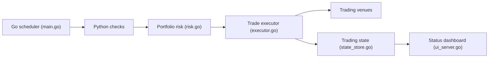

# richkuo/go-trader

> Crypto and derivatives trading bot, a Go scheduler that launches Python strategies, in paper or live mode.

## The problem
Running many strategies on several platforms with risk management requires a lot of orchestration code.

## What it actually does
A Go daemon launches short Python scripts at each cycle, receives JSON signals, executes orders in paper or live mode, applies limits (drawdown stop, daily losses, ATR stops) and keeps state in SQLite. Platforms: Binance US, Deribit, IBKR, Hyperliquid, TopStep, Robinhood, OKX, Luno. Discord/Telegram alerts, local dashboard, update on a simple "yes" in a private message.

## How it is wired


## Trying it
```bash
git clone https://github.com/richkuo/go-trader.git && cd go-trader
uv sync
cd scheduler && go build -o ../go-trader . && cd ..
./go-trader init
./go-trader --config scheduler/config.json --once
sudo bash scripts/install-service.sh
```

## Cost and gotchas
Exchange keys and Discord tokens to provide; live mode commits real money. Auto-update triggers on a reply to a private message. The README advises giving SKILL.md to an agent for installation.

## What it is not
Not a promise of profitability: the README states it is not financial advice. Older strategies are flagged as having no edge after a fee audit.

## Alternatives
No alternative named in the README.

## For you
Ignore: real financial risk and hard-to-audit trading code; only the architecture of a Go daemon + ephemeral Python scripts deserves a look.
