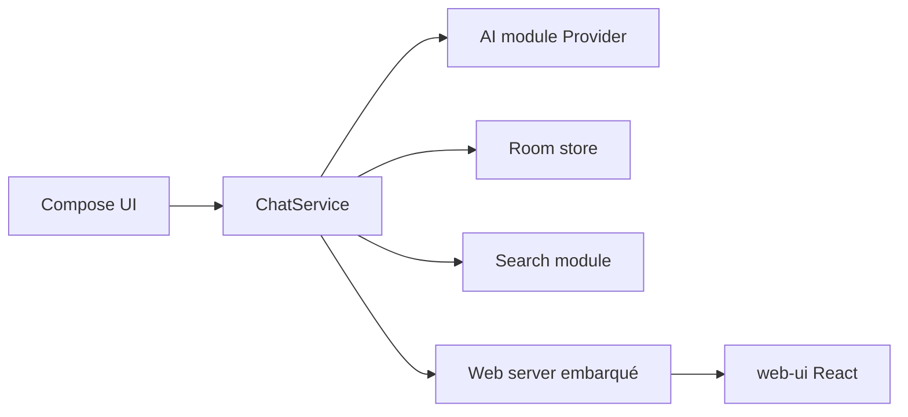

# rikkahub/rikkahub

> Native Android LLM chat client that switches between several model providers.

## The problem
Using several LLM providers on mobile forces you to juggle different apps.

## What it actually does
Kotlin and Jetpack Compose application: OpenAI, Claude and Google providers (customizable API), multimodal input (image, PDF, Docx), MCP and Skills support, web search (Exa, Tavily, Brave...), Markdown rendering with LaTeX and Mermaid, file-based memory, Silly Tavern card import, web access and WebDAV or S3 sync. A proot-based Linux workspace is mentioned.

## How it is wired

## Trying it
No command documented: download from the website or Google Play. To build, a `google-services.json` file is required in `app`.

## Cost and gotchas
Free, but you pay for provider calls with your own keys. The README warns about numerous forks. The project does not accept pull requests. AGPL-3.0 license.

## What it is not
Not a model nor a service: it depends on external providers to respond.

## Alternatives
- No alternative named in the README.

## For you
Ignore: a mobile chat client, no value for an MLOps pipeline, except as a personal interface.
