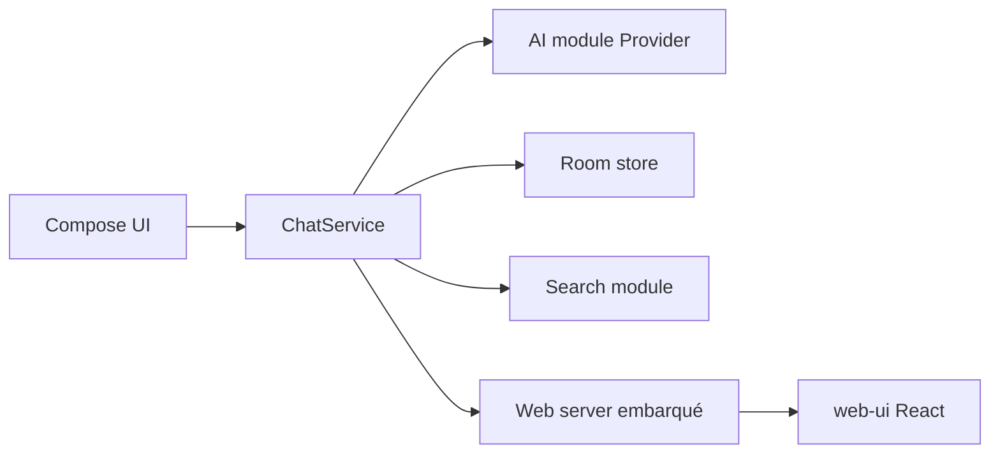

# rikkahub/rikkahub

> Client Android natif de chat LLM, qui bascule entre plusieurs fournisseurs de modèles.

## Le problème
Utiliser plusieurs fournisseurs de LLM sur mobile oblige à jongler entre applications différentes.

## Ce que ça fait vraiment
Application Kotlin et Jetpack Compose : fournisseurs OpenAI, Claude et Google (API personnalisable), entrée multimodale (image, PDF, Docx), support MCP et Skills, recherche web (Exa, Tavily, Brave…), rendu Markdown avec LaTeX et Mermaid, mémoire par fichiers, import de cartes Silly Tavern, accès web et synchronisation WebDAV ou S3. Un espace de travail Linux basé sur proot est mentionné.

## Comment c'est branché

## Essayer
Aucune commande documentée : téléchargement depuis le site ou Google Play. Pour compiler, un fichier `google-services.json` est requis dans `app`.

## Coût et pièges
Gratuit, mais tu paies les appels aux fournisseurs avec tes clés. Le README met en garde contre de nombreux forks. Le projet n'accepte pas de pull requests. Licence AGPL-3.0.

## Ce que ce n'est pas
Pas un modèle ni un service : il dépend de fournisseurs externes pour répondre.

## Alternatives
- Aucune alternative nommée dans le README.

## Pour toi
À ignorer : client mobile de chat, sans valeur pour un pipeline MLOps, sauf comme interface personnelle.

