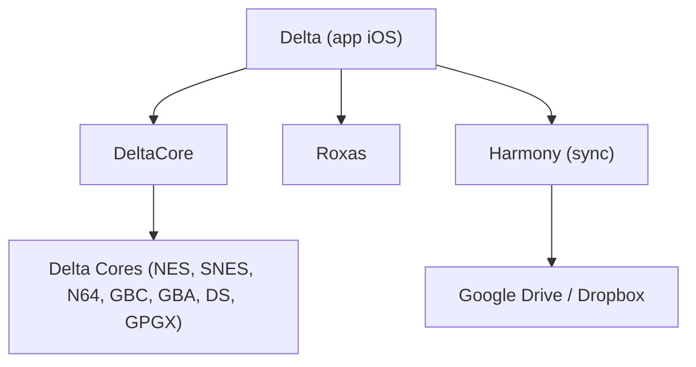

# rileytestut/Delta

> Classic console emulator for non-jailbroken iPhone and iPad, installed via AltStore.

## The problem
Apple does not allow emulators in the App Store, which prevents playing classic games on iOS.

## What it actually does
Delta emulates NES, SNES, N64, Game Boy (Color), GBA, DS and Genesis using existing cores. It offers save states, cheats, controllers, skins, fast forward and sync via Google Drive or Dropbox.

## How it is wired


## Trying it
```bash
git clone https://github.com/rileytestut/Delta.git
cd Delta
git submodule update --init --recursive
```

## Cost and gotchas
Installed via AltStore, with a refresh every 7 days. Building requires Xcode 15, Swift 5.9, iOS 14 and Git LFS (requirements outside the list). AGPLv3 license. You must supply the games yourself.

## What it is not
It is not a game catalog. It does not work without AltStore or sideloading, and it is not an App Store application.

## Alternatives
- GBA4iOS: the predecessor, cited as an ancestor.

## For you
Ignore: iOS game emulator, unrelated to a data / AI / MLOps profile.
