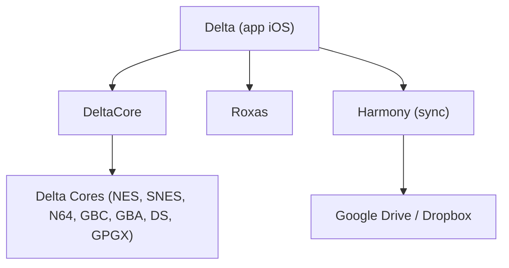

# rileytestut/Delta

> Émulateur de consoles classiques pour iPhone et iPad non jailbreakés, installé via AltStore.

## Le problème
Apple n'autorise pas les émulateurs dans l'App Store, ce qui empêche de jouer à des jeux classiques sur iOS.

## Ce que ça fait vraiment
Delta émule NES, SNES, N64, Game Boy (Color), GBA, DS et Genesis grâce à des cœurs existants. Il offre états de sauvegarde, cheats, manettes, skins, avance rapide et synchronisation via Google Drive ou Dropbox.

## Comment c'est branché


## Essayer
```bash
git clone https://github.com/rileytestut/Delta.git
cd Delta
git submodule update --init --recursive
```

## Coût et pièges
Installation via AltStore, avec un rafraîchissement tous les 7 jours. La compilation demande Xcode 15, Swift 5.9, iOS 14 et Git LFS (besoins hors liste). Licence AGPLv3. Tu dois fournir toi-même les jeux.

## Ce que ce n'est pas
Ce n'est pas un catalogue de jeux. Il ne fonctionne pas sans AltStore ou sideloading, et ce n'est pas une application de l'App Store.

## Alternatives
- GBA4iOS : le prédécesseur, cité comme ancêtre.

## Pour toi
À ignorer : émulateur de jeux iOS, sans rapport avec un profil data / IA / MLOps.

