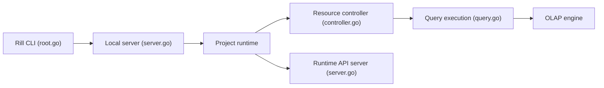

# rilldata/rill

> BI-as-code tool (YAML + SQL) on ClickHouse or DuckDB, designed for agents and analysts.

## The problem
BI dashboards are built by clicking, hard to version and hard to get a coding agent to write.

## What it actually does
You describe SQL models, metrics views (dimensions, measures) and dashboards in YAML. Rill Developer runs them locally on DuckDB or ClickHouse; `rill deploy` pushes them to Rill Cloud, which adds conversational BI, an MCP server, alerts and reports. `rill init` can generate instructions for Claude or other agents.

## How it is wired


## Trying it
```bash
curl https://rill.sh | sh
rill start my-project
rill init
rill deploy
```

## Cost and gotchas
Local use is free; cloud features (hosted MCP, alerts, deployment) go through Rill Cloud, an account-based offering. Large volumes require ClickHouse.

## What it is not
Not a no-code self-service visualization tool: everything is defined in files. The README does not document cloud pricing.

## Alternatives
No alternative named in the README.

## For you
Worth watching: the BI-as-code approach with a semantic layer speaks to a data profile, but the full value depends on the paid cloud.
