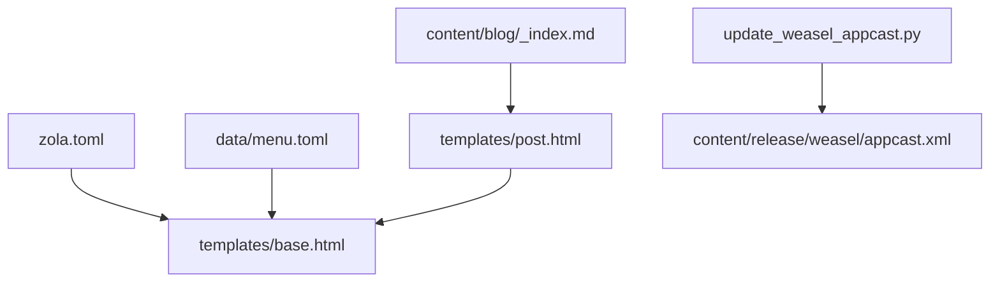

# rime/home

> Home repository of the Rime project: website, documentation and issue tracking.

## The problem
A software project needs a central place for its website, its documentation and the triage of problems.

## What it actually does
The very short README points to the wiki and the discussions, and asks that general reports be filed there. The architecture shows that the site is generated by Zola (`zola.toml`, `data/`, `templates/`, `content/`) and that a script `update_weasel_appcast.py` updates the Weasel `appcast.xml` feed. What Rime is is not stated in the README.

## How it is wired


## Trying it
```bash
# Aucune commande documentée
```

## Cost and gotchas
Free (MIT). Nothing to install; the useful content is in the external wiki. The repository has many open issues (503).

## What it is not
Not the Rime software itself, but its website and ticket triage. Insufficient material to say more.

## Alternatives
No alternative cited in the README.

## For you
Ignore: an empty website shell, with no technical content usable in data, AI or MLOps.
