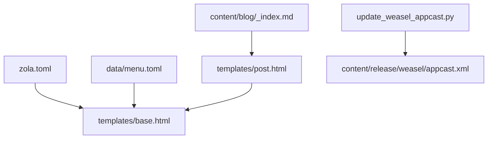

# rime/home

> Dépôt d'accueil du projet Rime : site, documentation et suivi des signalements.

## Le problème
Un projet logiciel a besoin d'un lieu central pour son site, sa documentation et le tri des problèmes.

## Ce que ça fait vraiment
Le README, très court, renvoie au wiki et aux discussions, et demande d'y déposer les signalements généraux. L'architecture indique que le site est généré par Zola (`zola.toml`, `data/`, `templates/`, `content/`) et qu'un script `update_weasel_appcast.py` met à jour le flux `appcast.xml` de Weasel. Ce qu'est Rime n'est pas dit dans le README.

## Comment c'est branché


## Essayer
```bash
# Aucune commande documentée
```

## Coût et pièges
Gratuit (MIT). Rien à installer ; le contenu utile se trouve dans le wiki externe. Le dépôt compte de nombreuses issues ouvertes (503).

## Ce que ce n'est pas
Pas le logiciel Rime lui-même, mais son site et son tri de tickets. Matière insuffisante pour en dire plus.

## Alternatives
Aucune alternative citée dans le README.

## Pour toi
À ignorer : coquille de site web, sans contenu technique exploitable en data, IA ou MLOps.

