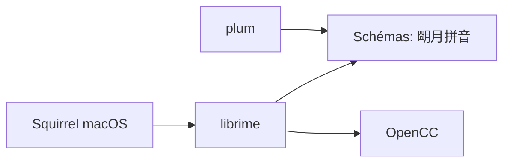

# rime/squirrel

> "鼠鬚管" input method for macOS, based on the Rime engine, for typing Chinese.

## The problem
Typing Chinese (and other writing systems) on macOS with a configurable engine.

## What it actually does
macOS frontend of the Rime engine (librime). Works on macOS 13.0+, is enabled through the input menu icon, schema menu via `Ctrl+`` or `F4`. Customization through configuration files, then "Redeploy". Additional schemas via the plum manager.

## How it is wired

## Trying it
No command: install the package, then choose the ㄓ icon in the input methods menu. If nothing types, log out and back in.

## Cost and gotchas
Free. README written in Traditional Chinese; GPL-3.0 license.

## What it is not
Not a translation tool. The Linux (ibus-rime, fcitx-rime) and Windows (小狼毫) versions are separate projects.

## Alternatives
中州韻 (ibus-rime, fcitx-rime) for Linux; 小狼毫 for Windows, cited in the README.

## For you
Ignore: useful only for Chinese input on Mac, unrelated to data/AI.
