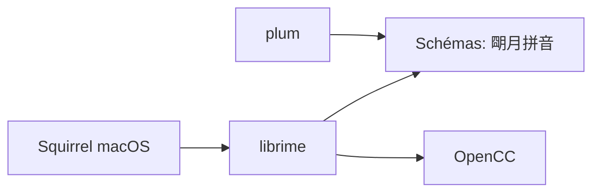

# rime/squirrel

> Méthode de saisie « 鼠鬚管 » pour macOS, basée sur le moteur Rime, pour écrire en chinois.

## Le problème
Saisir du chinois (et d'autres systèmes d'écriture) sur macOS avec un moteur configurable.

## Ce que ça fait vraiment
Frontend macOS du moteur Rime (librime). Fonctionne sur macOS 13.0+, s'active via l'icône du menu d'entrée, menu des schémas par `Ctrl+`` ou `F4`. Personnalisation par fichiers de configuration, puis « Redéployer ». Schémas supplémentaires via le gestionnaire plum.

## Comment c'est branché

## Essayer
Aucune commande : installer le paquet, puis choisir l'icône ㄓ dans le menu des méthodes de saisie. Si rien ne s'écrit, se déconnecter/reconnecter.

## Coût et pièges
Gratuit. README rédigé en chinois traditionnel ; licence GPL-3.0.

## Ce que ce n'est pas
Pas un outil de traduction. Les versions Linux (ibus-rime, fcitx-rime) et Windows (小狼毫) sont des projets distincts.

## Alternatives
中州韻 (ibus-rime, fcitx-rime) pour Linux ; 小狼毫 pour Windows, cités dans le README.

## Pour toi
Ignorer : utile uniquement pour la saisie chinoise sur Mac, sans lien avec le data/IA.

