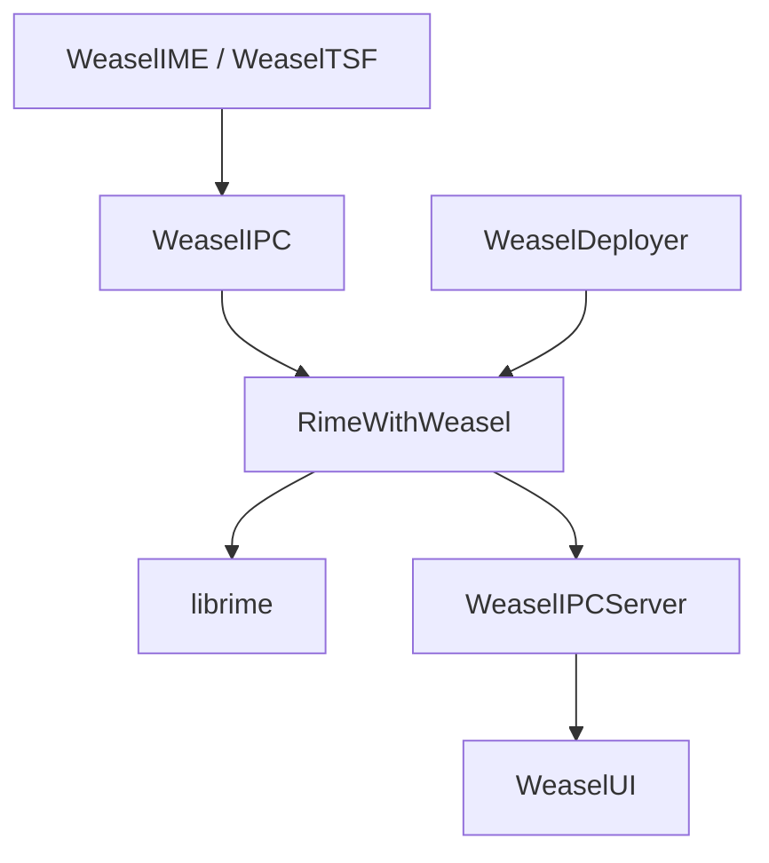

# rime/weasel

> 小狼毫 Chinese input method for Windows, built on the Rime engine, for people who type in Chinese.

## The problem
Typing Chinese on Windows with customizable schemas, without depending on a proprietary editor.

## What it actually does
Weasel registers itself as a Windows input method (classic IME and Text Services Framework). It sends keystrokes to the Rime engine, displays the candidate list and applies the schemas configured in YAML. A deployer recompiles the configuration after any change.

## How it is wired
Simplified diagram based on the sheet.


## Trying it
```bash
# Aucune commande dans le README : installer via le programme d'installation Windows,
# puis choisir 小狼毫 dans l'indicateur de méthode de saisie.
# Raccourci cité : Ctrl+` ou F4 pour le menu des schémas.
```

## Cost and gotchas
Free. Windows 8.1 to 11 only; the README is in Traditional Chinese. After any configuration change, you must redeploy.

## What it is not
It is not a portable input engine: for Linux or macOS the README cites ibus-rime, fcitx5-rime and 鼠鬚管. The engine itself is librime, which is separate.

## Alternatives
- ibus-rime, fcitx5-rime or fcitx-rime: for Linux.
- 鼠鬚管: for macOS.

## For you
Ignore for data/AI work: it is a Chinese input tool for Windows, useful only if you type in Chinese.
