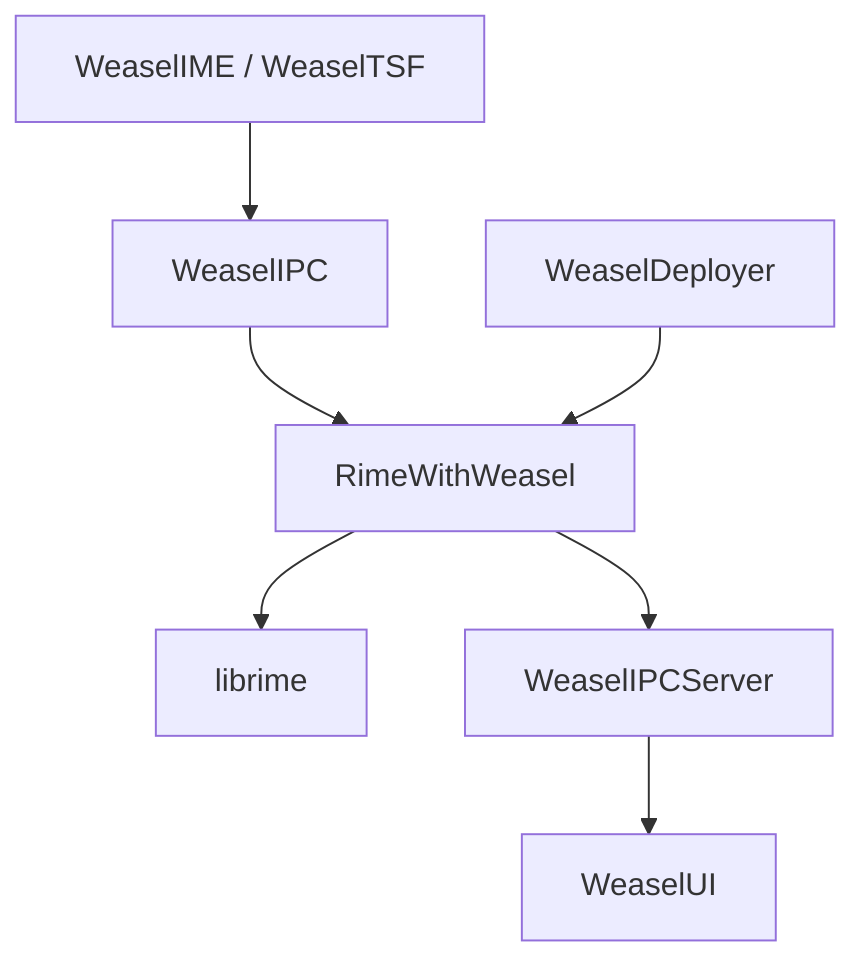

# rime/weasel

> Méthode de saisie chinoise 小狼毫 pour Windows, bâtie sur le moteur Rime, pour qui tape en chinois.

## Le problème
Saisir du chinois sous Windows avec des schémas personnalisables, sans dépendre d'un éditeur propriétaire.

## Ce que ça fait vraiment
Weasel s'enregistre comme méthode de saisie Windows (IME classique et Text Services Framework). Il envoie les frappes au moteur Rime, affiche la liste de candidats et applique les schémas configurés en YAML. Un déployeur recompile la configuration après modification.

## Comment c'est branché
Schéma simplifié d'après la fiche.


## Essayer
```bash
# Aucune commande dans le README : installer via le programme d'installation Windows,
# puis choisir 小狼毫 dans l'indicateur de méthode de saisie.
# Raccourci cité : Ctrl+` ou F4 pour le menu des schémas.
```

## Coût et pièges
Gratuit. Réservé à Windows 8.1 à 11 ; le README est en chinois traditionnel. Après toute modification de configuration, il faut redéployer.

## Ce que ce n'est pas
Ce n'est pas un moteur de saisie portable : pour Linux ou macOS le README cite ibus-rime, fcitx5-rime et 鼠鬚管. Le moteur lui-même est librime, à part.

## Alternatives
- ibus-rime, fcitx5-rime ou fcitx-rime : pour Linux.
- 鼠鬚管 : pour macOS.

## Pour toi
À ignorer pour un travail data/IA : c'est un outil de saisie chinoise sous Windows, utile seulement si tu tapes en chinois.

