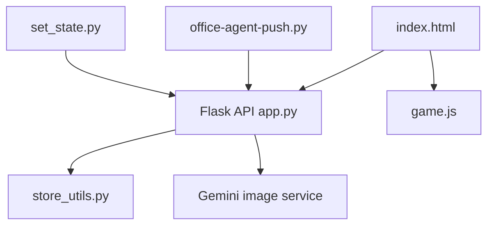

# ringhyacinth/Star-Office-UI

> Pixel-art dashboard that shows in real time what your AI agents are doing.

## The problem
It is hard to see who is working on what, or whether an agent is online or in error.

## What it actually does
A Flask service receives an agent's state (6 states: idle, writing, researching, executing, syncing, error) and a web page animates characters toward the matching zone. It handles several agents via an invitation key, a "yesterday" note read from `memory/*.md`, and three languages. Option: backgrounds generated via Gemini, Electron desktop version.

## How it is wired


## Trying it
```bash
git clone https://github.com/ringhyacinth/Star-Office-UI.git
cd Star-Office-UI
python3 -m pip install -r backend/requirements.txt
cp state.sample.json state.json
cd backend
python3 app.py
# puis, dans un autre terminal :
python3 set_state.py writing "En cours"
```

## Cost and gotchas
Python 3.10+ required. Gemini optional (key at your expense). In production: set strong `FLASK_SECRET_KEY` and `ASSET_DRAWER_PASS`.

## What it is not
Not a serious monitoring tool. The code is MIT but the graphic assets forbid commercial use. Best experience with OpenClaw.

## Alternatives
No alternative named in the README.

## For you
Worth watching: an amusing gadget to visualize agents, but a restrictive graphics license and limited MLOps use.
