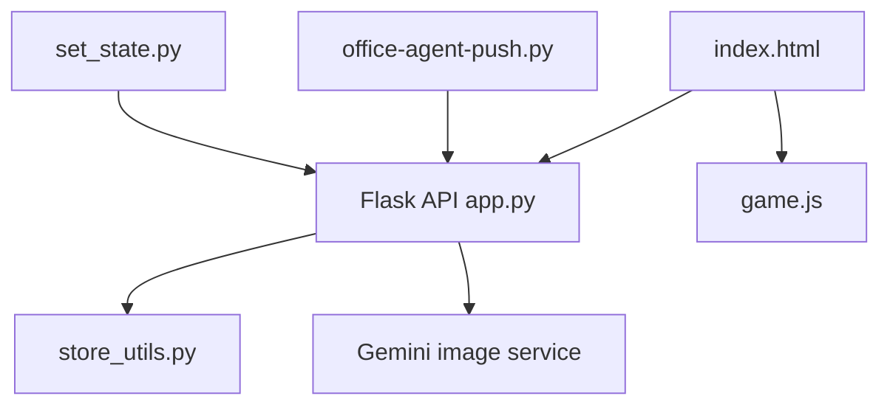

# ringhyacinth/Star-Office-UI

> Tableau de bord pixel-art qui montre en temps réel ce que font tes agents IA.

## Le problème
On ne voit pas facilement qui travaille sur quoi, ni si un agent est en ligne ou en erreur.

## Ce que ça fait vraiment
Un service Flask reçoit l'état d'un agent (6 états : idle, writing, researching, executing, syncing, error) et une page web anime des personnages vers la zone correspondante. Il gère plusieurs agents via clé d'invitation, une note « hier » lue depuis `memory/*.md` et trois langues. Option : fonds générés via Gemini, version bureau Electron.

## Comment c'est branché


## Essayer
```bash
git clone https://github.com/ringhyacinth/Star-Office-UI.git
cd Star-Office-UI
python3 -m pip install -r backend/requirements.txt
cp state.sample.json state.json
cd backend
python3 app.py
# puis, dans un autre terminal :
python3 set_state.py writing "En cours"
```

## Coût et pièges
Python 3.10+ requis. Gemini facultatif (clé à ta charge). En production : définir `FLASK_SECRET_KEY` et `ASSET_DRAWER_PASS` forts.

## Ce que ce n'est pas
Pas un outil de supervision sérieux. Le code est MIT mais les ressources graphiques interdisent l'usage commercial. Expérience optimale avec OpenClaw.

## Alternatives
Aucune alternative nommée dans le README.

## Pour toi
À surveiller : gadget amusant pour visualiser des agents, mais licence graphique restrictive et usage MLOps limité.

