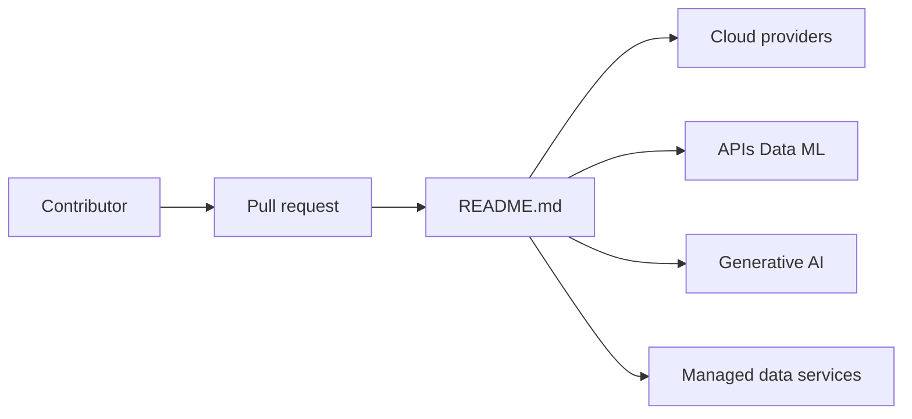

# ripienaar/free-for-dev

> A comprehensive list of SaaS, PaaS, and IaaS services, with free offerings, specifically tailored for developers and operations teams.

## The problem
The free offers are scattered, frequently change, and their limitations are difficult to compare.

## What it actually does
A comprehensive README categorizes services by areas: major cloud providers, CI/CD, monitoring, email, authentication, managed databases, hosting, generative AI, and more. Each line indicates the free quota. Criteria: service hosted (not software to be installed), at least one year of free service, TLS not restricted to paid plans. Useful categories here: APIs, Data and ML, Generative AI (Langfuse, Opik, Braintrust…), Managed Data Services (Qdrant, Neon).

## How it is wired


## Trying it
```bash
# aucune commande : lire le README, proposer un ajout par pull request
```

## Cost and gotchas
Free. The quotas are changing, and some lines indicate that a service has been discontinued. No license is declared in the deposit.

## What it is not
This is not a recommendation; the list is subjective and not verified on a service-by-service basis. There is no self-hosted software.

## Alternatives
No alternative is specified in the README file.

## For you
Useful as a bookmark: helpful for finding free LLM, vector, or GPU testing resources, and for cross-referencing them before relying on them.
