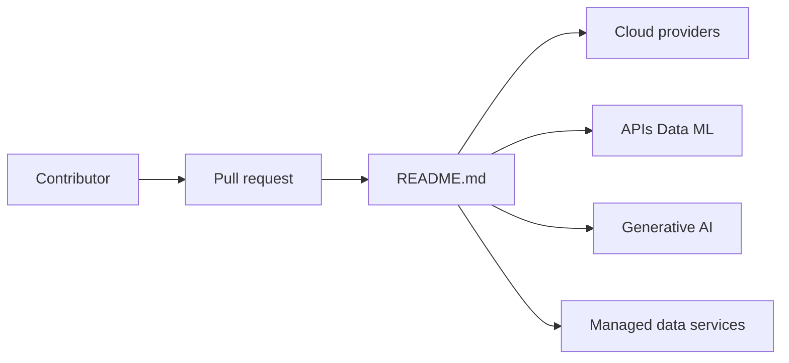

# ripienaar/free-for-dev

> Liste commentée de services SaaS, PaaS et IaaS avec offre gratuite, pour développeurs et ops.

## Le problème
Les offres gratuites sont dispersées, changent souvent et leurs limites sont difficiles à comparer.

## Ce que ça fait vraiment
Un README géant classe les services par rubriques : clouds majeurs, CI/CD, monitoring, e-mail, authentification, bases managées, hébergement, IA générative et plus. Chaque ligne indique le quota gratuit. Critères : service hébergé (pas du logiciel à installer), offre gratuite d'au moins un an, TLS non réservé aux plans payants. Les rubriques utiles ici : APIs, Data et ML, Generative AI (Langfuse, Opik, Braintrust…), Managed Data Services (Qdrant, Neon).

## Comment c'est branché


## Essayer
```bash
# aucune commande : lire le README, proposer un ajout par pull request
```

## Coût et pièges
Gratuit. Les quotas changent, et certaines lignes signalent un service disparu. Aucune licence n'est déclarée sur le dépôt.

## Ce que ce n'est pas
Pas une recommandation : la liste est opinionnée et non vérifiée service par service. Pas de logiciel auto-hébergé.

## Alternatives
Aucune alternative nommée dans le README.

## Pour toi
À surveiller en marque-page : utile pour trouver un niveau gratuit de suivi LLM, de vecteurs ou de GPU de test, à recouper avant d'en dépendre.

