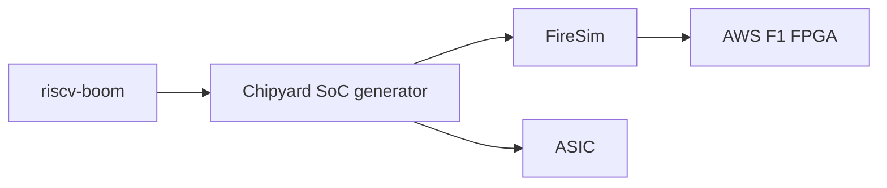

# riscv-boom/riscv-boom

> Synthesizable out-of-order RISC-V RV64GC core written in Chisel, for architecture research.

## The problem
Microarchitecture research lacks open, parameterizable, synthesizable out-of-order cores.

## What it actually does
A parameterizable RISC-V RV64GCB core generator (SonicBOOM, BOOMv3), synthesizable for ASIC or FPGA, with IEEE 754 FPU, atomics, caches, virtual memory; it boots Linux, runs SPEC, and claims 6.2 CoreMark/MHz. Developed by the Berkeley Architecture Research group.

## How it is wired


## Trying it
```bash
# Le dépôt n'est pas autonome : utiliser Chipyard (hash dans CHIPYARD.hash).
# Aucune commande dans le README.
```

## Cost and gotchas
Free, but AWS F1 FPGA is billed through FireSim. Heavy hardware toolchain.

## What it is not
Not a repository that runs on its own: Chipyard is required. Announced as under active development.

## Alternatives
The README names no alternative.

## For you
Ignore: processor design, outside the data/AI scope, unless you are interested in hardware.
