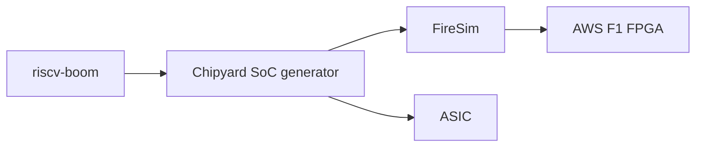

# riscv-boom/riscv-boom

> Cœur RISC-V RV64GC out-of-order synthétisable écrit en Chisel, pour la recherche en architecture.

## Le problème
La recherche en microarchitecture manque de cœurs out-of-order ouverts, paramétrables et synthétisables.

## Ce que ça fait vraiment
Générateur de cœur RISC-V RV64GCB (SonicBOOM, BOOMv3), paramétrable, synthétisable ASIC ou FPGA, avec FPU IEEE 754, atomiques, caches, mémoire virtuelle ; boote Linux, exécute SPEC, 6,2 CoreMark/MHz annoncés. Développé par le groupe Berkeley Architecture Research.

## Comment c'est branché


## Essayer
```bash
# Le dépôt n'est pas autonome : utiliser Chipyard (hash dans CHIPYARD.hash).
# Aucune commande dans le README.
```

## Coût et pièges
Gratuit, mais FPGA AWS F1 facturé via FireSim. Chaîne d'outils matérielle lourde.

## Ce que ce n'est pas
Pas un dépôt qui tourne seul : il faut Chipyard. Annoncé en développement actif.

## Alternatives
Le README ne nomme pas d'alternative.

## Pour toi
À ignorer : conception de processeurs, hors périmètre data/IA, sauf intérêt pour le matériel.

