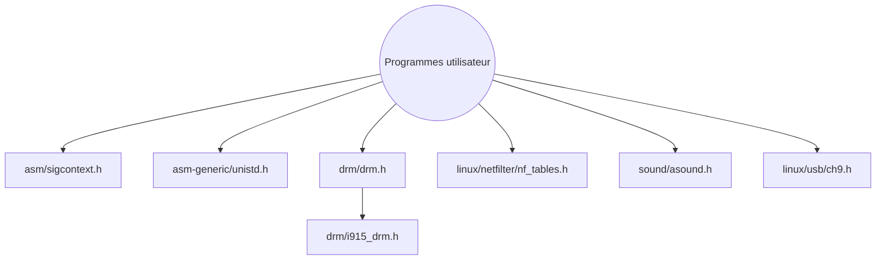

# riscv-collab/riscv-gnu-toolchain

> C/C++ cross-compilation toolchain for RISC-V, for those targeting RISC-V boards or Linux.

## The problem
Compiling code for a RISC-V chip from an x86 or ARM machine requires a cross compiler, its C libraries and debugging tools, assembled by hand.

## What it actually does
It downloads and builds GCC, binutils, GDB and a C library of your choice (Newlib, Picolibc, glibc, musl, uClibc), bare-metal or Linux. `configure` sets the architecture, the ABI, multilib and the built-in QEMU; the Dejagnu test suite runs on a simulator. LLVM/clang is optional (`--enable-llvm`).

## How it is wired
Diagram based on the provided graph, which only shows the repository's Linux headers, not the compiler.



## Trying it
```bash
git clone https://github.com/riscv/riscv-gnu-toolchain
./configure --prefix=/opt/riscv
make
./configure --prefix=/opt/riscv --with-arch=rv32gc --with-abi=ilp32d
```

## Cost and gotchas
The clone weighs about 6.65 GB and the build requires about 8 GiB of disk. On macOS a case-sensitive volume is needed. On Ubuntu, many packages must be installed first.

## What it is not
Not a ready-to-use compiler: you build it yourself, at length. The `make check` targets are only wired for Newlib and glibc.

## Alternatives
No alternative named in the README.

## For you
Ignore for a data/AI/MLOps profile: it is a low-level embedded tool, unrelated to data pipelines or models.
