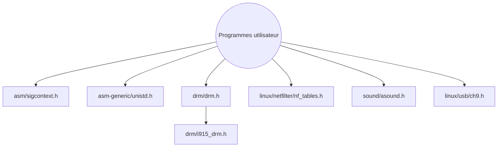

# riscv-collab/riscv-gnu-toolchain

> Chaîne de compilation croisée C/C++ pour RISC-V, pour qui cible des cartes ou du Linux RISC-V.

## Le problème
Compiler du code pour une puce RISC-V depuis une machine x86 ou ARM exige un compilateur croisé, ses bibliothèques C et ses outils de débogage, assemblés à la main.

## Ce que ça fait vraiment
Il télécharge et compile GCC, binutils, GDB et une bibliothèque C au choix (Newlib, Picolibc, glibc, musl, uClibc), en bare-metal ou Linux. Le `configure` règle l'architecture, l'ABI, le multilib et le QEMU intégré ; la suite de tests Dejagnu tourne sur simulateur. LLVM/clang est optionnel (`--enable-llvm`).

## Comment c'est branché
Schéma d'après le diagramme fourni, qui ne montre que les en-têtes Linux du dépôt, pas le compilateur.



## Essayer
```bash
git clone https://github.com/riscv/riscv-gnu-toolchain
./configure --prefix=/opt/riscv
make
./configure --prefix=/opt/riscv --with-arch=rv32gc --with-abi=ilp32d
```

## Coût et pièges
Le clone pèse environ 6,65 Go et la compilation exige environ 8 Gio de disque. Sur macOS il faut un volume sensible à la casse. Sur Ubuntu, de nombreux paquets sont à installer avant.

## Ce que ce n'est pas
Pas un compilateur prêt à l'emploi : on le construit soi-même, longuement. Les cibles `make check` ne sont câblées que pour Newlib et glibc.

## Alternatives
Aucune alternative nommée dans le README.

## Pour toi
À ignorer pour un profil data/IA/MLOps : c'est un outil d'embarqué bas niveau, sans lien avec les pipelines de données ni les modèles.

