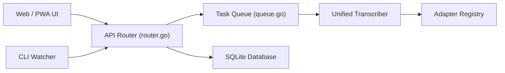

# rishikanthc/Scriberr

> Self-hosted, offline audio transcription app with diarization and chat with your transcripts.

## The problem
Transcription services send the audio to a cloud and bill by the hour.

## What it actually does
You upload or record audio in a web interface (PWA). Local models (Whisper, NVIDIA Parakeet and Canary) transcribe with word-level timestamps, and diarization labels the speakers. A watched folder processes new files. Summaries and chat go through Ollama or an OpenAI-compatible API.

## How it is wired


## Trying it
```bash
brew tap rishikanthc/scriberr
brew install scriberr
scriberr
docker compose up -d
docker compose -f docker-compose.cuda.yml up -d
```

## Cost and gotchas
Free. First startup is long (model downloads). An NVIDIA GPU speeds things up considerably; RTX 50 cards require a dedicated image. Over plain HTTP, you need `SECURE_COOKIES=false`.

## What it is not
Not fully offline if you enable chat through OpenAI. The author has had development pauses, then announced a resumption.

## Alternatives
No alternative named in the README.

## For you
Adopt it to transcribe meetings privately on your own server: it is concrete and local, with the risk of a single maintainer.
