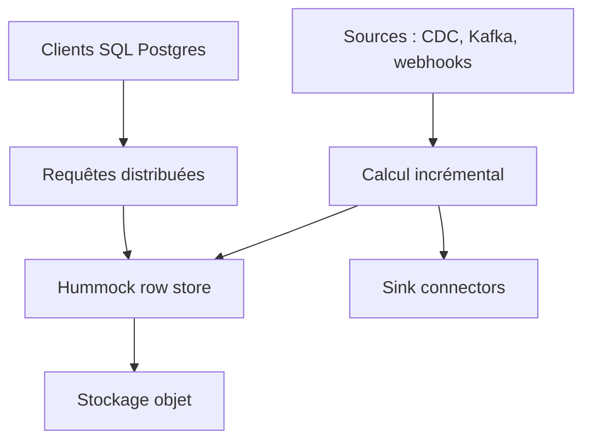

# risingwavelabs/risingwave

> Streaming SQL database that ingests, processes incrementally and serves fresh data, with Iceberg storage.

## The problem
Chaining Debezium, Kafka, Flink and a serving database multiplies latency and operational load.

## What it actually does
Ingestion from webhooks, CDC (PostgreSQL, MySQL), brokers (Kafka, Pulsar, Kinesis) and S3 batches. Incremental computation via materialized views, results served over the Postgres protocol, state storage on object storage (Hummock) and writing to Apache Iceberg with a built-in REST catalog. An MCP server, a CLI and Skills are provided for agents.

## How it is wired


## Trying it
```bash
curl -L https://risingwave.com/sh | sh
```

## Cost and gotchas
Self-hosted is free (Docker Compose, Helm, Operator); RisingWave Cloud is the managed option. Object storage is at your expense. Anonymous statistics and Scarf, can be disabled.

## What it is not
Not a classic batch warehouse. The announced latencies (under 100 ms, 10-20 ms p99) are the vendor's own.

## Alternatives
Debezium, Kafka and Flink are cited as the stack being replaced.

## For you
Adopt: relevant for real-time features and MLOps streaming, with an Apache-2.0 license and a very active project.
