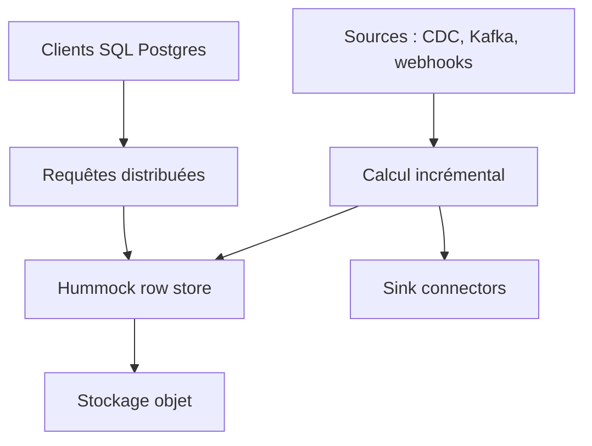

# risingwavelabs/risingwave

> Base de streaming SQL qui ingère, traite en incrémental et sert des données fraîches, avec stockage Iceberg.

## Le problème
Chaîner Debezium, Kafka, Flink et une base de service multiplie latence et charge d'exploitation.

## Ce que ça fait vraiment
Ingestion depuis webhooks, CDC (PostgreSQL, MySQL), brokers (Kafka, Pulsar, Kinesis) et lots S3. Calcul incrémental via vues matérialisées, service des résultats par protocole Postgres, stockage d'état sur objet (Hummock) et écriture vers Apache Iceberg avec catalogue REST intégré. Un serveur MCP, une CLI et des Skills sont fournis pour les agents.

## Comment c'est branché


## Essayer
```bash
curl -L https://risingwave.com/sh | sh
```

## Coût et pièges
Auto-hébergé gratuit (Docker Compose, Helm, Operator) ; RisingWave Cloud est l'option gérée. Stockage objet à ta charge. Statistiques anonymes et Scarf, désactivables.

## Ce que ce n'est pas
Pas un entrepôt batch classique. Les latences annoncées (moins de 100 ms, 10-20 ms p99) sont celles de l'éditeur.

## Alternatives
Debezium, Kafka et Flink sont cités comme la pile remplacée.

## Pour toi
Adopter : pertinent pour des features temps réel et du streaming MLOps, avec une licence Apache-2.0 et un projet très actif.

