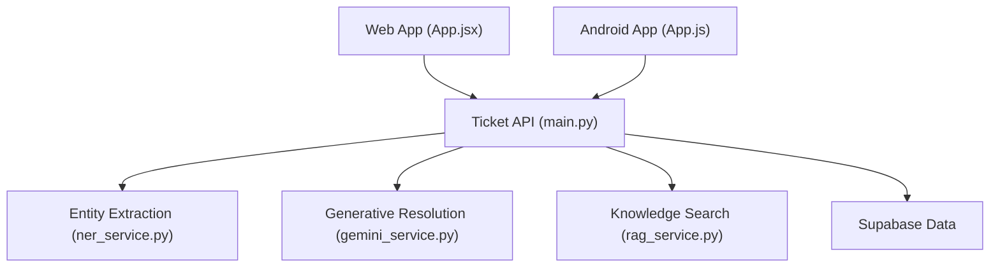

# ritesh-1918/HELPDESK.AI

> Multi-company helpdesk that classifies IT tickets with AI and suggests fixes; web and Android.

## The problem
Manual triage of IT tickets (category, priority, duplicates) slows down first-level support.

## What it actually does
Ticket creation with classification (DistilBERT claimed), entity extraction (hostnames, IPs, serial numbers), duplicate detection, OCR and generative resolution via GitHub Models/Gemini. Four permission levels, multi-tenant through Supabase (RLS). The "milliseconds" and "100% of tickets" figures are README claims, not measured.

## How it is wired


## Trying it
```bash
git clone https://github.com/ritesh-1918/HELPDESK.AI.git
cd HELPDESK.AI/Frontend
npm install
npm run dev
# .env du dossier /Frontend : VITE_SUPABASE_URL, VITE_SUPABASE_ANON_KEY, VITE_STRIPE_GROWTH_LINK, VITE_BACKEND_URL
```

## Cost and gotchas
A Supabase project to create, a FastAPI backend to launch (command not documented), access to GitHub Models/Gemini. The README only details the frontend.

## What it is not
Not a turnkey solution: backend startup and model training/loading are not documented. 180 open issues.

## Alternatives
No alternative named in the README.

## For you
Worth watching: an example of an NLP + LLM pipeline for ticketing, to read for the architecture, not to deploy for lack of backend documentation.
