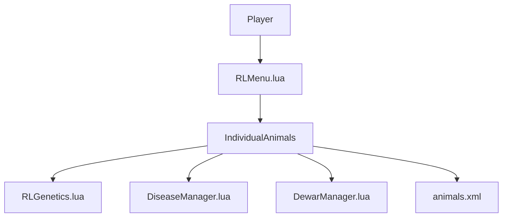

# rittermod/FS25_RealisticLivestockRM

> Farming Simulator 25 mod: individual livestock tracking with genetics, diseases and automation, a maintained version of Arrow-kb's mod.

## The problem
In FS25, animals are mere groups with no identity; livestock farming stays shallow. The original author stopped development.

## What it actually does
- Each animal has its own identity, heritable genetics, weight, health and production.
- Breeding, insemination (dewars), ten diseases with vaccination and treatment.
- RL menu (Right Shift + O): sorting, selling, saved filters, automated "herdsman" tasks.
- Multiplayer support, compatibility bridges for maps and mods; save migration from Arrow-kb.

## How it is wired


## Trying it
```bash
# Pas de commande : placer FS25_RealisticLivestockRM.zip dans le dossier mods de FS25
# Migration : retirer FS25_RealisticLivestock.zip et FS25_FontLibrary.zip, sauvegarder la partie avant
```

## Cost and gotchas
Free, but you must own Farming Simulator 25. Incompatible with FS25_EnhancedLivestock, FS25_MoreVisualAnimals and FS25_EnhancedAnimalSystem.

## What it is not
Not a work tool: a game mod. The author says they aim for stability rather than the original ambitious roadmap. GPL-3.0.

## Alternatives
- Arrow-kb Realistic Livestock: the original, abandoned.
- Renfordt Enhanced Livestock: source of inspiration for the disease system, but incompatible.

## For you
Ignore: a game mod unrelated to data / AI / MLOps, only of interest if you play FS25.
