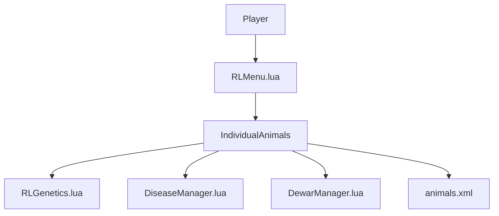

# rittermod/FS25_RealisticLivestockRM

> Mod pour Farming Simulator 25 : suivi individuel du bétail avec génétique, maladies et automatisation, version maintenue du mod d'Arrow-kb.

## Le problème
Dans FS25, les animaux sont de simples groupes sans identité ; l'élevage reste superficiel. L'auteur d'origine a arrêté le développement.

## Ce que ça fait vraiment
- Chaque animal a identité, génétique héritable, poids, santé et production propres.
- Reproduction, insémination (dewars), dix maladies avec vaccination et traitement.
- Menu RL (Maj droite + O) : tri, vente, filtres sauvegardés, tâches « herdsman » automatisées.
- Support multijoueur, ponts de compatibilité pour cartes et mods ; migration des sauvegardes d'Arrow-kb.

## Comment c'est branché


## Essayer
```bash
# Pas de commande : placer FS25_RealisticLivestockRM.zip dans le dossier mods de FS25
# Migration : retirer FS25_RealisticLivestock.zip et FS25_FontLibrary.zip, sauvegarder la partie avant
```

## Coût et pièges
Gratuit, mais il faut posséder Farming Simulator 25. Incompatible avec FS25_EnhancedLivestock, FS25_MoreVisualAnimals et FS25_EnhancedAnimalSystem.

## Ce que ce n'est pas
Pas un outil de travail : un mod de jeu. L'auteur indique viser la stabilité plutôt que la feuille de route ambitieuse d'origine. GPL-3.0.

## Alternatives
- Arrow-kb Realistic Livestock : l'original, abandonné.
- Renfordt Enhanced Livestock : source d'inspiration du système de maladies, mais incompatible.

## Pour toi
À ignorer : mod de jeu sans rapport avec data / IA / MLOps, intéressant seulement si tu joues à FS25.

