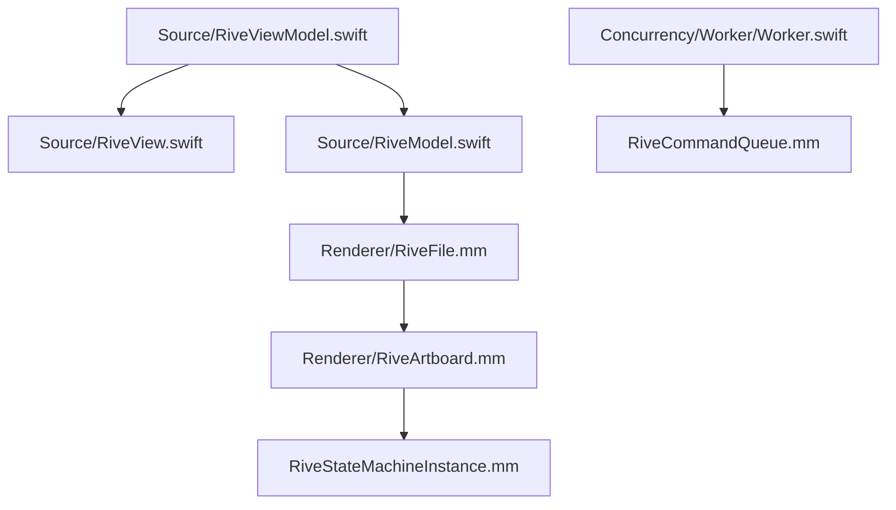

# rive-app/rive-ios

> Apple runtime library that plays interactive Rive animations in UIKit, AppKit and SwiftUI apps.

## The problem
Embedding vector animations that react to interactions in an iOS or macOS app requires a dedicated engine.

## What it actually does
`RiveViewModel` drives `RiveModel` and `RiveView` on top of the Rive C++ engine (artboards, state machines, inputs). A concurrency layer offers an asynchronous API with `Worker` and a command queue. Distributed via Swift Package Manager and CocoaPods.

## How it is wired
Schema derived from the code diagram.

## Trying it
The README gives no install command: open `RiveRuntime.xcworkspace` in Xcode with the `Preview (iOS)` or `Preview (macOS)` scheme.

## Cost and gotchas
Free. Requires Xcode (the real need is not in the prerequisites list) and animation files created in the Rive editor.

## What it is not
Not the Rive animation editor: only the Apple player. No link to data.

## Alternatives
No alternative named in the README.

## For you
Ignore: animation runtime for Apple apps, outside the data / AI / MLOps scope.
