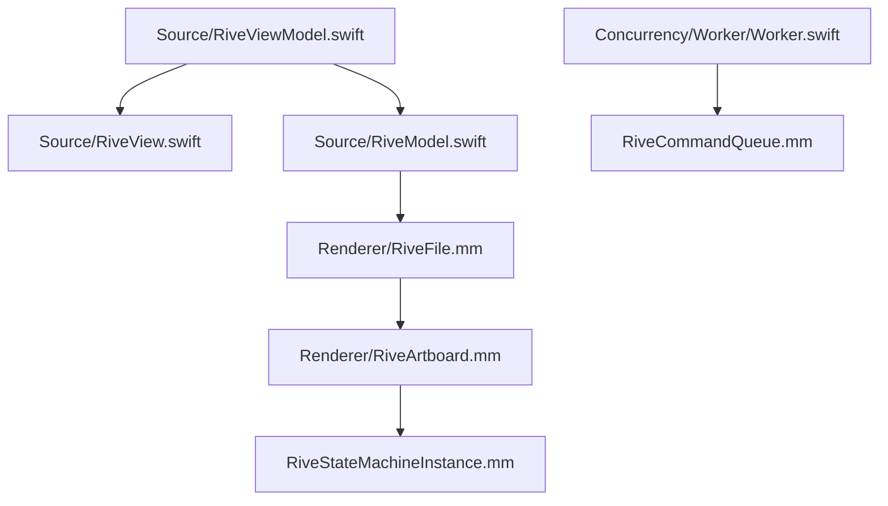

# rive-app/rive-ios

> Bibliothèque d'exécution Apple qui lit des animations interactives Rive dans des apps UIKit, AppKit et SwiftUI.

## Le problème
Intégrer dans une app iOS ou macOS des animations vectorielles qui réagissent aux interactions demande un moteur dédié.

## Ce que ça fait vraiment
`RiveViewModel` pilote `RiveModel` et `RiveView` au-dessus du moteur C++ Rive (artboards, machines à états, entrées). Une couche de concurrence propose une API asynchrone avec `Worker` et file de commandes. Distribuée par Swift Package Manager et CocoaPods.

## Comment c'est branché
Schéma d'après le diagramme du code.

## Essayer
Le README ne donne pas de commande d'installation : ouvrir `RiveRuntime.xcworkspace` dans Xcode avec le schéma `Preview (iOS)` ou `Preview (macOS)`.

## Coût et pièges
Gratuit. Nécessite Xcode (le besoin réel n'est pas dans la liste des prérequis) et des fichiers d'animation créés dans l'éditeur Rive.

## Ce que ce n'est pas
Pas l'éditeur d'animations Rive : seulement le lecteur Apple. Pas de lien avec la data.

## Alternatives
Aucune alternative nommée dans le README.

## Pour toi
À ignorer : runtime d'animation pour apps Apple, hors du périmètre data / IA / MLOps.

