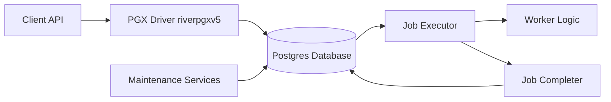

# riverqueue/river

> Go job queue backed by Postgres, with transactional enqueueing.

## The problem
A separate queue (Redis, broker) desynchronizes jobs and data: a job can go out even though the transaction failed.

## What it actually does
Jobs are defined by a `JobArgs` / `Worker` pair, identified by a "kind".
`InsertTx` inserts the job in the same transaction as the data: visible only on commit.
Multiple queues, scheduled and periodic jobs, unique jobs, snooze, cancellation, batch insertion (`COPY FROM`).
Maintenance services (cleanup, rescue), leader election, separate web UI; insertion from Python and Ruby.

## How it is wired

## Trying it
No shell command in the README: Go code examples (`river.NewClient`, `InsertTx`) and a pointer to the docs.

## Cost and gotchas
Free; requires Postgres. MPL-2.0 (weak copyleft).

## What it is not
Not a workflow orchestrator nor a multi-language queue: jobs run in Go, other languages only insert.

## Alternatives
Cited inspirations, not compared: Oban (Elixir), Sidekiq, Que, GoodJob (Ruby), Hangfire (.NET).

## For you
Ignore on the Python side: excellent if your backend is in Go on Postgres, otherwise no entry point for a data pipeline.
