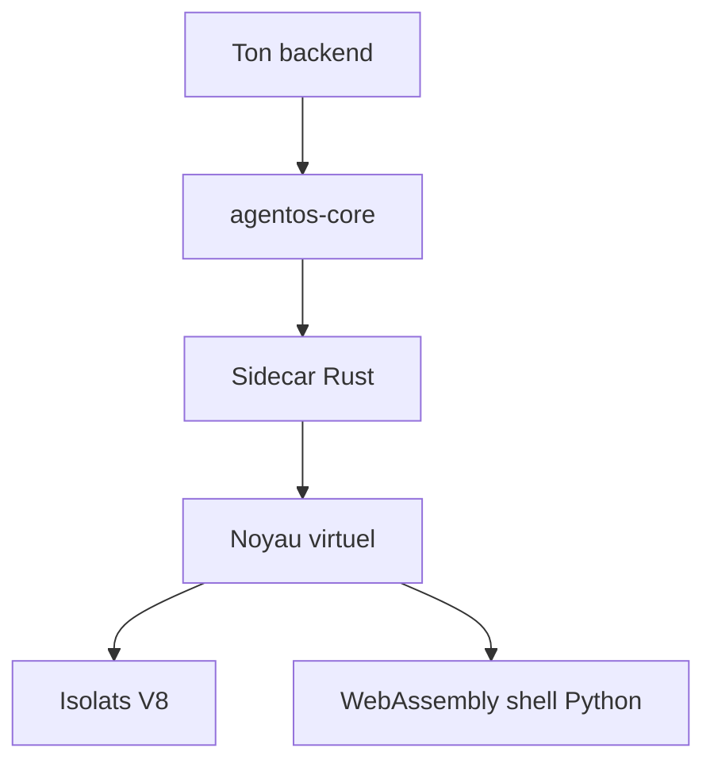

# rivet-dev/agent-os

> Lightweight Linux sandbox in WebAssembly and V8, embedded in your process to run agent code.

## The problem
Giving an agent a shell and files implies one virtual machine per agent, slow and expensive.

## What it actually does
The library starts a virtualized kernel in a side Rust process (sidecar). JavaScript runs in V8 isolates, the shell and Python in WebAssembly. Files (memory, SQLite, S3), processes, network and resource limits are controlled by permissions (network denied by default). Hosted mode on Rivet Cloud or self-hosted.

## How it is wired
Simplified diagram based on the sheet, no diagram provided.


## Trying it
```bash
npm install @rivet-dev/agentos-core
```
```ts
const vm = await AgentOs.create();
await vm.process.exec("echo hello");
await vm.dispose();
```

## Cost and gotchas
Free library. Hosted mode requires a Rivet account (RIVET_TOKEN). The benchmarks (92 times faster) come from the authors, against an unspecified baseline.

## What it is not
Not a full virtual machine: the Linux is emulated, not all binaries run. Not hardware isolation.

## Alternatives
No alternative named in the README.

## For you
Worth watching: useful for running agent code at low cost, but real Linux compatibility remains to be tested.
