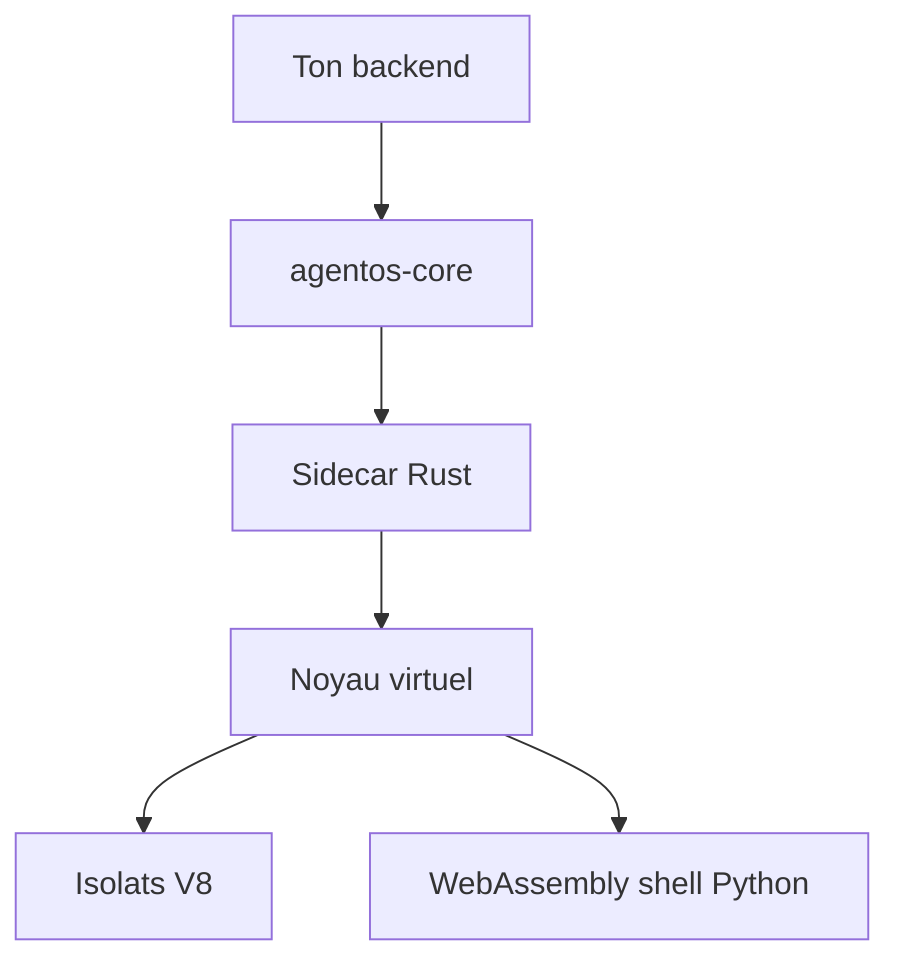

# rivet-dev/agentos

> Bac à sable Linux léger en WebAssembly et V8, intégré dans ton processus pour exécuter du code d'agent.

## Le problème
Donner un shell et des fichiers à un agent suppose une machine virtuelle par agent, lente et chère.

## Ce que ça fait vraiment
La bibliothèque lance un noyau virtualisé dans un processus Rust annexe (sidecar). JavaScript tourne dans des isolats V8, le shell et Python en WebAssembly. Fichiers (mémoire, SQLite, S3), processus, réseau et limites de ressources sont contrôlés par des permissions (réseau refusé par défaut). Mode hébergé sur Rivet Cloud ou auto-hébergé. Même README que rivet-dev/agent-os.

## Comment c'est branché
Schéma simplifié d'après la fiche, sans diagramme fourni.


## Essayer
```bash
npm install @rivet-dev/agentos-core
```
```ts
const vm = await AgentOs.create();
await vm.process.exec("echo hello");
await vm.dispose();
```

## Coût et pièges
Bibliothèque gratuite. Le mode hébergé demande un compte Rivet (RIVET_TOKEN). Les benchmarks (92 fois plus rapide) viennent des auteurs, contre une référence non précisée.

## Ce que ce n'est pas
Pas une machine virtuelle complète : le Linux est émulé, tous les binaires ne tournent pas. Pas une isolation matérielle.

## Alternatives
Aucune alternative nommée dans le README.

## Pour toi
À surveiller : utile pour faire exécuter du code d'agent à bas coût, mais la compatibilité Linux réelle reste à tester.

