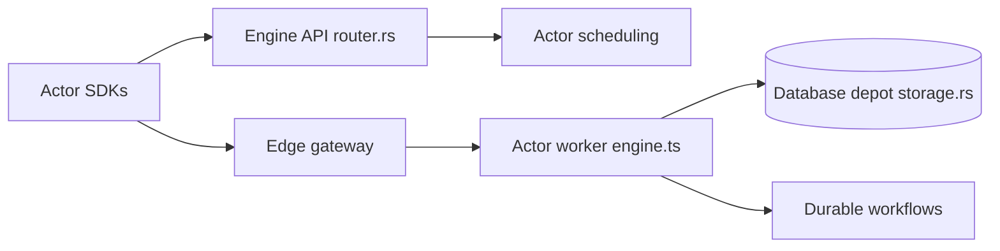

# rivet-dev/rivet

> Durable actor platform, with state, SQLite and WebSocket, for running AI agents at scale.

## The problem
Running each agent in a sandbox or VM is expensive in memory and startup, while it spends most of its time waiting for inference.

## What it actually does
An actor is a durable process with in-memory variables, a SQLite database, WebSocket and scheduling, which goes to sleep and wakes on demand. Actors share a Node.js or Bun process. The Rust control plane schedules, routes and persists; data lives on S3 object storage. Libraries for agents, workflows and secure code execution (agentOS).

## How it is wired


## Trying it
```bash
npx skills add rivet-dev/skills
```
The README suggests pasting this instruction into a coding agent, then asking what to build.

## Cost and gotchas
Self-hosting is free (Apache-2.0), with S3 object storage as the only dependency. Rivet Cloud and BYOC are managed offerings. The figures (4.99 ms, 72 KB) come from the vendor's benchmarks.

## What it is not
Not a sandbox provider: to run untrusted code you need agentOS or your own sandbox. The Python and Swift clients are experimental.

## Alternatives
- Cloudflare Durable Objects: Rivet presents itself as an open, self-hostable equivalent, without the 128 MB cap.
- E2B: sandbox compared in the README, heavier at startup.

## For you
Worth watching: interesting for hosting durable, multi-user agents without a VM per agent, but a young platform to evaluate before tying your workflows to it.
