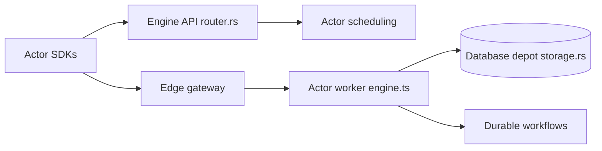

# rivet-dev/rivet

> Plateforme d'acteurs durables, avec état, SQLite et WebSocket, pour exécuter des agents IA à grande échelle.

## Le problème
Faire tourner chaque agent dans un bac à sable ou une VM coûte cher en mémoire et en démarrage, alors qu'il passe l'essentiel du temps à attendre l'inférence.

## Ce que ça fait vraiment
Un acteur est un processus durable avec variables en mémoire, base SQLite, WebSocket et planification, qui se met en veille puis se réveille à la demande. Les acteurs partagent un processus Node.js ou Bun. Le plan de contrôle en Rust planifie, route et persiste ; les données vivent sur stockage objet S3. Bibliothèques pour agents, workflows et exécution sécurisée de code (agentOS).

## Comment c'est branché


## Essayer
```bash
npx skills add rivet-dev/skills
```
Le README propose de coller cette consigne dans un agent de code, puis de demander quoi construire.

## Coût et pièges
Auto-hébergement gratuit (Apache-2.0), avec un stockage objet S3 comme seule dépendance. Rivet Cloud et BYOC sont des offres gérées. Les chiffres (4,99 ms, 72 Ko) viennent des benchmarks de l'éditeur.

## Ce que ce n'est pas
Pas un fournisseur de bacs à sable : pour exécuter du code non fiable il faut agentOS ou ton propre bac à sable. Les clients Python et Swift sont expérimentaux.

## Alternatives
- Cloudflare Durable Objects : Rivet se présente comme équivalent ouvert, auto-hébergeable, sans plafond de 128 Mo.
- E2B : bac à sable comparé dans le README, plus lourd au démarrage.

## Pour toi
À surveiller : intéressant pour héberger des agents durables et multi-utilisateurs sans une VM par agent, mais plateforme jeune à évaluer avant d'y lier tes workflows.

