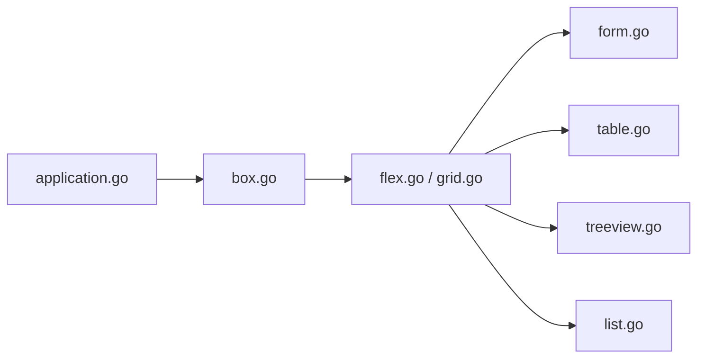

# rivo/tview

> Go widget library for terminal interfaces: forms, tables, trees, lists.

## The problem
Building an interactive terminal interface in Go from scratch means handling screen, focus and layout.

## What it actually does
Provides components: forms (fields, checkboxes, buttons), text area, navigable colored text view, table, tree, list, image, grid/flex/pages layouts, modal windows, an `Application` wrapper. Built on tcell and uniseg. Highly customizable and extensible. Cited by many projects (K9s, gh, lazysql...).

## How it is wired


## Trying it
```bash
go get github.com/rivo/tview@master
```
```go
box := tview.NewBox().SetBorder(true).SetTitle("Hello, world!")
if err := tview.NewApplication().SetRoot(box, true).Run(); err != nil {
    panic(err)
}
```

## Cost and gotchas
Free. Backward compatibility is sought but not guaranteed (tcell changes, bug fixes, internal interfaces such as `Primitive`). Single maintainer.

## What it is not
Not a graphical framework: terminal only.

## Alternatives
No alternative named in the README.

## For you
Solid for writing a terminal operations tool (MLOps dashboards, log browsers) if you work in Go; otherwise out of scope.
