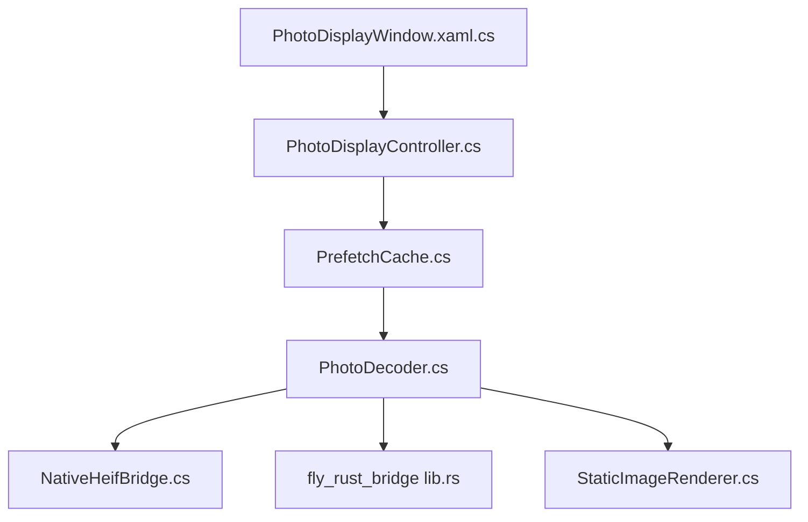

# riyasy/FlyPhotos

> Fast Windows photo viewer, built with WinUI 3, replacement for Picasa Photo Viewer.

## The problem
Windows viewers are slow on large folders and handle recent formats poorly.

## What it actually does
Native AOT startup, memory and disk cache, continuous navigation by holding the arrow keys. Formats: everything WIC reads, plus PSD, HEIC, AVIF, SVG, GIF/APNG, animated WebP, RAW. Reconfigurable keyboard and mouse shortcuts, EXIF panel, 20 languages.

## How it is wired


## Trying it
```bash
# Aucune commande shell : installer depuis le Microsoft Store,
# ou télécharger le MSI (x64 ou ARM64) de la page Releases.
```

## Cost and gotchas
The Store version is paid, the MSI is free but unsigned. Windows 10 build 17763 or later. HDR rendered as SDR, SVG limited to 2000 px, multiple instances in beta. License not identified by GitHub.

## What it is not
Not a photo management or editing tool. Windows only.

## Alternatives
No alternative named in the README.

## For you
Ignore: personal convenience on Windows, unrelated to data or AI.
