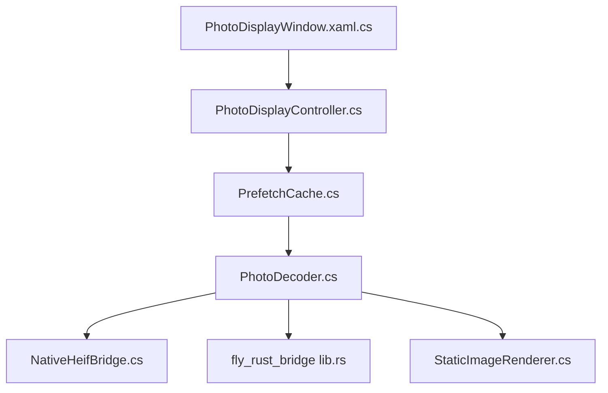

# riyasy/FlyPhotos

> Visionneuse de photos Windows rapide, en WinUI 3, remplaçante du Picasa Photo Viewer.

## Le problème
Les visionneuses de Windows sont lentes sur de gros dossiers et gèrent mal les formats récents.

## Ce que ça fait vraiment
Démarrage natif AOT, cache mémoire et disque, navigation continue par maintien des flèches. Formats : tout ce que WIC lit, plus PSD, HEIC, AVIF, SVG, GIF/APNG, WebP animé, RAW. Raccourcis clavier et souris reconfigurables, panneau EXIF, 20 langues.

## Comment c'est branché


## Essayer
```bash
# Aucune commande shell : installer depuis le Microsoft Store,
# ou télécharger le MSI (x64 ou ARM64) de la page Releases.
```

## Coût et pièges
Le Store est payant, le MSI gratuit mais non signé. Windows 10 build 17763 ou plus. HDR rendu en SDR, SVG limité à 2000 px, instances multiples en bêta. Licence non identifiée par GitHub.

## Ce que ce n'est pas
Pas un outil de gestion ou de retouche photo. Windows uniquement.

## Alternatives
Aucune alternative nommée dans le README.

## Pour toi
Ignorer : confort personnel sous Windows, sans rapport avec la data ou l'IA.

