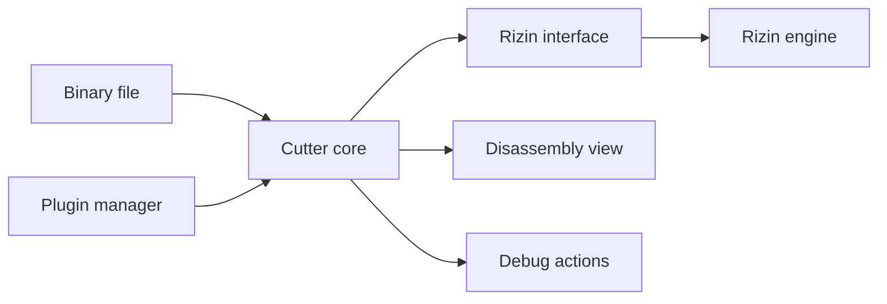

# rizinorg/cutter

> Free reverse-engineering platform with a Qt interface, built on Rizin, for binary analysts.

## The problem
Disassembling, analyzing and debugging a binary without scattered tools.

## What it actually does
Opens a binary, has the Rizin engine analyze it, then offers functions, disassembly, decompiler, graphs, search, hex view and debugging. Extensible through Python or C++ plugins (e.g. the Ghidra decompiler).

## How it is wired


## Trying it
```bash
chmod +x Cutter*.AppImage; ./Cutter*.AppImage
brew install --cask cutter
choco install cutter
```

## Cost and gotchas
Free. Last push on 2026-09-11. Cutter is an interface: the analysis engine is Rizin.

## What it is not
Not an automated security tool: the analysis remains manual.

## Alternatives
None named in the README (the Ghidra decompiler is cited as a plugin).

## For you
Ignore: reverse-engineering tool, useful only if you analyze binaries.
