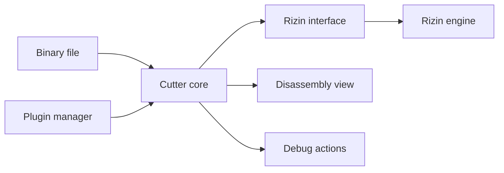

# rizinorg/cutter

> Plateforme libre de rétro-ingénierie en interface Qt, fondée sur Rizin, pour analystes de binaires.

## Le problème
Désassembler, analyser et déboguer un binaire sans outils éparpillés.

## Ce que ça fait vraiment
Ouvre un binaire, le fait analyser par le moteur Rizin, puis propose fonctions, désassemblage, décompilateur, graphes, recherche, vue hexadécimale et débogage. Extensible par plugins Python ou C++ (ex. décompilateur Ghidra).

## Comment c'est branché


## Essayer
```bash
chmod +x Cutter*.AppImage; ./Cutter*.AppImage
brew install --cask cutter
choco install cutter
```

## Coût et pièges
Gratuit. Dernier push le 2026-09-11. Cutter est une interface : le moteur d'analyse est Rizin.

## Ce que ce n'est pas
Pas un outil de sécurité automatisé : l'analyse reste manuelle.

## Alternatives
Aucune nommée dans le README (le décompilateur Ghidra est cité en plugin).

## Pour toi
Ignorer : outil de rétro-ingénierie, utile seulement si tu analyses des binaires.

