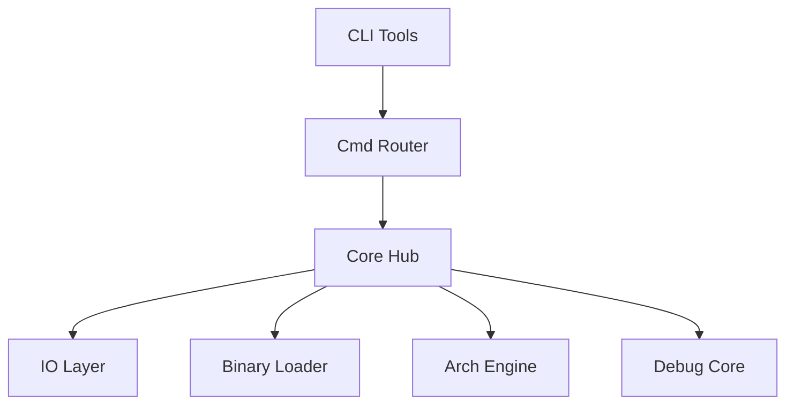

# rizinorg/rizin

> Command-line reverse-engineering framework for analyzing, disassembling and debugging binaries.

## The problem
Understanding an executable without its sources requires combining a disassembler, analysis, a debugger and a hex editor.

## What it actually does
Rizin is a C library with fine-grained tools (`rizin`, `rz-bin`, `rz-asm`, `rz-diff`, `rz-hash`, `rz-find`, `rz-sign`…). The `librz/core` core orchestrates file opening, analysis, debugging and search. It relies on layers for input/output, format parsing and architectures (ESIL and RZIL), and is driven by scripts via rzpipe (Python, Go, Rust…).

## How it is wired


## Trying it
```bash
git clone https://github.com/rizinorg/rizin
meson setup build
meson compile -C build
sudo meson install -C build
```

## Cost and gotchas
Free. Meson 0.55 or later (installable with pip). Many bundled dependencies and platforms; see BUILDING.md.

## What it is not
It is not an intrusion tool: it is an analysis tool. It does not automate understanding a binary; you need to master assembly. It is a fork of radare2.

## Alternatives
No alternative named in the README (radare2 is cited as the origin of the fork).

## For you
Keep an eye on it: useful for inspecting a suspicious binary or library from a dependency chain, without serving a data or AI profile day to day.
