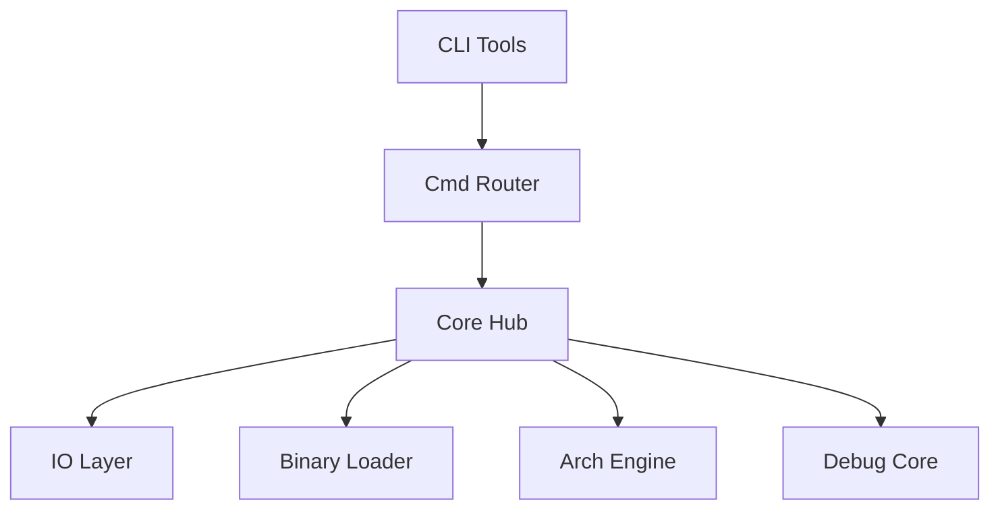

# rizinorg/rizin

> Cadriciel de rétro-ingénierie en ligne de commande pour analyser, désassembler et déboguer des binaires.

## Le problème
Comprendre un exécutable sans ses sources demande de combiner désassembleur, analyse, débogueur et éditeur hexadécimal.

## Ce que ça fait vraiment
Rizin est une bibliothèque C avec des outils fins (`rizin`, `rz-bin`, `rz-asm`, `rz-diff`, `rz-hash`, `rz-find`, `rz-sign`…). Le cœur `librz/core` orchestre l'ouverture de fichiers, l'analyse, le débogage et la recherche. Il s'appuie sur des couches d'entrées-sorties, d'analyse de formats, d'architectures (ESIL et RZIL), et pilote par des scripts via rzpipe (Python, Go, Rust…).

## Comment c'est branché


## Essayer
```bash
git clone https://github.com/rizinorg/rizin
meson setup build
meson compile -C build
sudo meson install -C build
```

## Coût et pièges
Gratuit. Meson 0.55 ou plus (installable avec pip). Beaucoup de dépendances embarquées et de plateformes ; voir BUILDING.md.

## Ce que ce n'est pas
Ce n'est pas un outil d'intrusion : c'est un outil d'analyse. Il n'automatise pas la compréhension d'un binaire, il faut maîtriser l'assembleur. Il est un fork de radare2.

## Alternatives
Aucune alternative nommée dans le README (radare2 est cité comme origine du fork).

## Pour toi
À surveiller : utile pour inspecter un binaire ou une bibliothèque suspecte d'une chaîne de dépendances, sans servir au quotidien un profil data ou IA.

