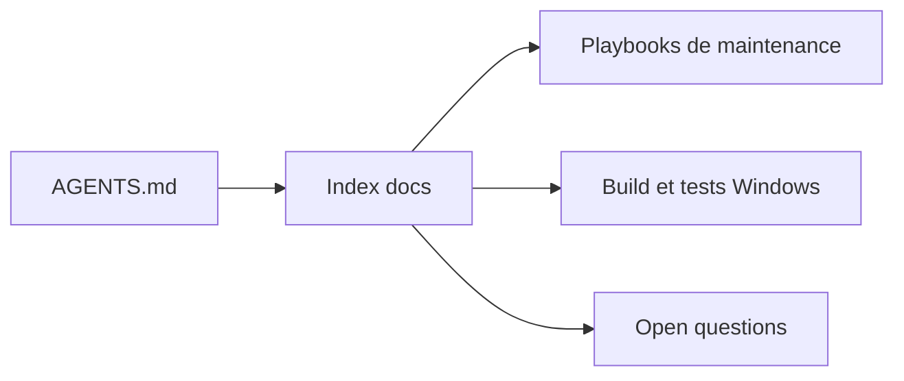

# rizonesoft/Notepad3

> The documentation index for contributors and code agents of the Notepad3 repository, a Windows text editor.

## The problem
Contributors and code agents need an entry point to find the repository's rules without browsing it all.

## What it actually does
The supplied text is an index of documentation pages, not a presentation of the editor. It gives the table of topics (MSBuild build, file I/O, encoding, lexers, localization, regex, dark mode) and maintenance rules, with a designated human approver. The README does not describe the product itself.

## How it is wired
Simplified diagram based on the sheet, no diagram supplied.

## Trying it
No command documented in this text. One docs-checker test is cited: `pwsh -NoProfile -File Build\scripts\tests\Test-Docs.Tests.ps1`.

## Cost and gotchas
Free. No license declared in the catalog: usage rights not established. The supplied content does not allow evaluating the editor.

## What it is not
Not an installation or product presentation page. Nothing here proves what the editor does.

## Alternatives
No alternative named in the README.

## For you
Ignore: insufficient material and no license; a Windows editor brings nothing to a data, AI or MLOps profile.
