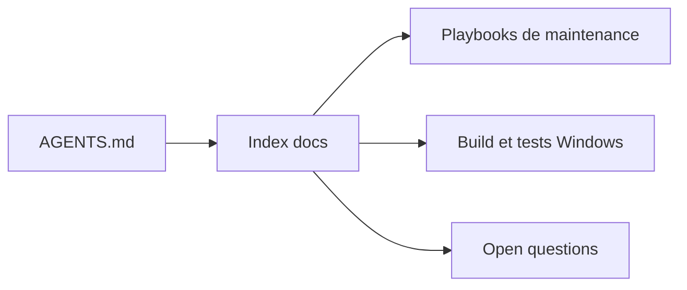

# rizonesoft/Notepad3

> L'index de documentation pour contributeurs et agents de code du dépôt Notepad3, éditeur de texte Windows.

## Le problème
Les contributeurs et les agents de code ont besoin d'un point d'entrée pour trouver les règles du dépôt sans le parcourir en entier.

## Ce que ça fait vraiment
Le texte fourni est un index de pages de documentation, pas la présentation de l'éditeur. Il donne la table des sujets (build MSBuild, E/S de fichiers, encodage, lexers, localisation, regex, mode sombre) et des règles de maintenance, avec un approbateur humain désigné. Le README ne décrit pas le produit lui-même.

## Comment c'est branché
Schéma simplifié d'après la fiche, sans diagramme fourni.

## Essayer
Aucune commande documentée dans ce texte. Un test du vérificateur de docs est cité : `pwsh -NoProfile -File Build\scripts\tests\Test-Docs.Tests.ps1`.

## Coût et pièges
Gratuit. Aucune licence déclarée au catalogue : droits d'usage non établis. Le contenu fourni ne permet pas d'évaluer l'éditeur.

## Ce que ce n'est pas
Pas une page d'installation ni de présentation du produit. Rien ici ne prouve ce que fait l'éditeur.

## Alternatives
Aucune alternative nommée dans le README.

## Pour toi
À ignorer : matière insuffisante et licence absente ; un éditeur Windows n'apporte rien à un profil data, IA ou MLOps.

