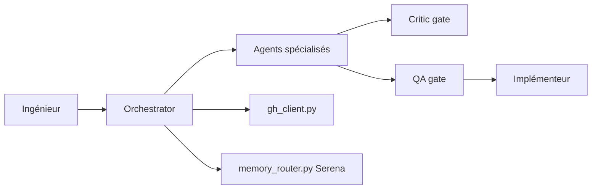

# rjmurillo/ai-agents

> Multi-agent toolkit for Claude Code and Copilot CLI, with an orchestrator, specialized agents and review gates.

## The problem
A lone coding agent chains analysis, planning, implementation and quality control poorly, and does not document its decisions.

## What it actually does
An orchestrator routes work to 30 agents (analyst, architect, implementer, critic, QA, security, DevOps...). Six lifecycle commands: `/spec`, `/plan`, `/build`, `/test`, `/review`, `/ship`. The critic returns APPROVED, APPROVED_WITH_CONCERNS, NEEDS_REVISION or BLOCKED; a QA failure sends work back to the implementer. Optional cross-session memory via Serena. No hook registered. Agents generated from shared templates for Claude, Copilot CLI and VS Code.

## How it is wired


## Trying it
```bash
/plugin marketplace add rjmurillo/ai-agents
/plugin install project-toolkit@ai-agents
```
To be typed in the Claude Code or Copilot CLI session.

## Cost and gotchas
Free, but consumes your assistant's tokens. Python 3.10+ for some skills. Gemini CLI and Codex CLI are not covered. 34 open issues.

## What it is not
Not an independent autonomous agent framework: it relies on Claude Code or Copilot CLI. Full cycles are heavy for a small task, which the README acknowledges.

## Alternatives
- AgentMux: tmux-driven pipeline across several CLIs.
- Claude Code or Copilot CLI alone, for a single-agent assistant.

## For you
Worth watching: the critic/QA/security gates and ADRs are a good basis for agent governance, but the project is still young and run by one person (49 stars).
