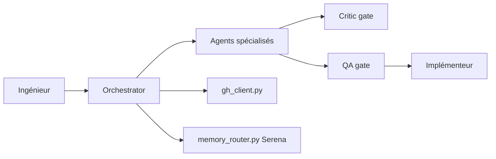

# rjmurillo/ai-agents

> Boîte à outils multi-agents pour Claude Code et Copilot CLI, avec orchestrateur, agents spécialisés et portes de revue.

## Le problème
Un agent de code seul enchaîne mal analyse, plan, implémentation et contrôle qualité, et ne documente pas ses décisions.

## Ce que ça fait vraiment
Un orchestrateur route le travail vers 30 agents (analyste, architecte, implémenteur, critique, QA, sécurité, DevOps…). Six commandes de cycle de vie : `/spec`, `/plan`, `/build`, `/test`, `/review`, `/ship`. Le critique rend APPROVED, APPROVED_WITH_CONCERNS, NEEDS_REVISION ou BLOCKED ; un échec QA renvoie à l'implémenteur. Mémoire inter-sessions optionnelle via Serena. Aucun hook enregistré. Agents générés depuis des modèles communs pour Claude, Copilot CLI et VS Code.

## Comment c'est branché


## Essayer
```bash
/plugin marketplace add rjmurillo/ai-agents
/plugin install project-toolkit@ai-agents
```
À saisir dans la session Claude Code ou Copilot CLI.

## Coût et pièges
Gratuit, mais consomme les jetons de ton assistant. Python 3.10+ pour certains skills. Gemini CLI et Codex CLI ne sont pas couverts. 34 issues ouvertes.

## Ce que ce n'est pas
Pas un framework d'agents autonomes indépendant : il s'appuie sur Claude Code ou Copilot CLI. Les cycles complets sont lourds pour une petite tâche, le README le reconnaît.

## Alternatives
- AgentMux : pipeline piloté par tmux sur plusieurs CLI.
- Claude Code ou Copilot CLI seuls, pour un assistant mono-agent.

## Pour toi
À surveiller : les portes critique/QA/sécurité et les ADR sont une bonne base de gouvernance d'agents, mais le projet reste jeune et porté par une personne (49 étoiles).

