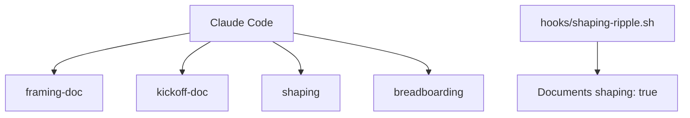

# rjs/shaping-skills

> Claude Code skills for framing a project and mapping a system, based on the Shape Up method.

## The problem
Turning team conversations into usable framing documents takes time, and an LLM on its own stays vague.

## What it actually does
- `/framing-doc` and `/kickoff-doc` convert transcripts into framing and kickoff documents.
- `/shaping` separates the problem (requirements) from the solution (shapes) with fit checks.
- `/breadboarding` describes a system as interface affordances, code affordances and their connections.
- A PostToolUse hook reminds you to check for side effects when editing `shaping: true` documents.

## How it is wired


## Trying it
```bash
git clone https://github.com/rjs/shaping-skills.git ~/.local/share/shaping-skills
ln -s ~/.local/share/shaping-skills/shaping ~/.claude/skills/shaping
ln -s ~/.local/share/shaping-skills/hooks/shaping-ripple.sh ~/.claude/hooks/shaping-ripple.sh
```

## Cost and gotchas
Free, but with no declared licence: reuse rights are unclear. The "document" skills reproduce the quality of the input word for word.

## What it is not
Not maintained: the author writes that these skills have been obsolete since the Opus 4.6 era.

## Alternatives
No alternative named in the README.

## For you
Ignore: the author himself considers them obsolete, they have no licence and are archived; only the idea of the reminder hook is worth borrowing.
